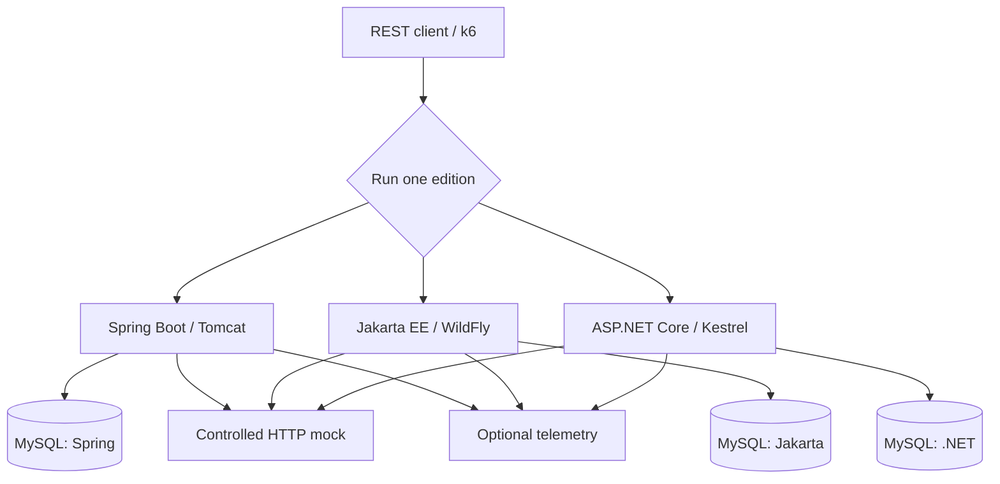

# Backend Engineering Lab

**Product catalogue · Caching · Concurrency · Async I/O · Runtime and architecture experiments**

An independently runnable, cross-framework engineering laboratory. Three implementations of one small product-catalogue scenario explore the same engineering questions without requiring a distributed product architecture. The focus is learning, correctness, repeatability and trade-offs, not declaring a universal framework winner.

> **Release status (2026-11-27): built, tested, benchmarked and reviewed.** All three editions build, pass their unit/integration tests and the common HTTP contract in Docker; all eight labs have measured results (JMH, BenchmarkDotNet, k6 with up to 5 repetitions); metrics and traces were verified end to end. Fourteen defects found during validation were fixed, and a clean-checkout reproduction passed ([validation](docs/VALIDATION_STATUS.md)). Feature coverage per lab and framework, open observations and limitations: [completion matrix](docs/ROADMAP.md).
>
> **Results:** [Consolidated benchmark report](reports/BENCHMARK_REPORT.md) · [Benchmark guide](docs/BENCHMARKS.md) · [Release notes](RELEASE_NOTES.md)

## 1. The originating problem

A web application has 100,000 product records. Each contains an ID, name and nullable `LastUpdatedTime`. The catalogue must be loaded into memory on startup, refreshed incrementally at regular intervals, and displayed ten records at a time. Newly inserted records may have no update timestamp. Readers may be active while the writer refreshes the cache.

The original coding exercise asked for an MVC page and optional client-side search. This lab intentionally uses a REST API and server-side search instead: it is not a submission that satisfies the original UI requirement. The core scenario remains recognizable, and the additional experiments explore stock reservation, product detail aggregation, price recalculation and price-change notifications.

### Research questions

- How does a thread-safe collection differ from an atomic catalogue snapshot?
- Can a naive timestamp/ID watermark miss a late commit? How can a transactional change journal avoid that class of failure?
- How do atomic operations and locks prevent lost updates and overselling?
- What is the difference between concurrency, asynchronous I/O and parallel CPU execution?
- Does Java 25 virtual-thread scheduling change I/O throughput compared with platform threads? How do Java 17 and 25 differ if both use platform threads? What did JDK 24+ change about pinning compared with Java 21?
- How do DI lifetimes affect allocation, shared state and resource ownership?
- When does an in-process event decouple side effects, and what durability guarantees does it not provide?
- How do resource limits and cache stampedes affect a system even when threads are plentiful?

## 2. Architecture



Each edition owns its database and cache. They do not call one another. Java editions reuse the same pure Java cache and experiment kernels so that JMH measures the application code, not a duplicate implementation. C# is an independent implementation. The Java Maven reactor includes the Spring app, shared cache core, JMH and Jakarta WAR. The .NET implementation has independent API, test and benchmark projects. Only one backend should be under load during a comparison.

## 3. Technology choices

| Concern | Spring | Jakarta EE | .NET |
|---|---|---|---|
| Runtime | JDK 25, 21 (pinning experiment) or 17 | JDK 25 | .NET 10 / 11 |
| Framework | Spring Boot 4.2.0 | Jakarta EE 11, WildFly 42 candidate image | ASP.NET Core |
| HTTP | Spring MVC on Tomcat | JAX-RS | Minimal APIs on Kestrel |
| Threads | Tomcat platform or virtual threads (`spring.threads.virtual.enabled`) | Default managed executor or virtual executor (Concurrency 3.1, `maxAsync=2000`) | ThreadPool, async/await |
| DI | Spring IoC | CDI | Built-in DI (`ValidateScopes`) |
| SQL | Spring JDBC | Explicit JDBC | MySqlConnector async ADO.NET |
| Connection pool | HikariCP | WildFly datasources (`@DataSourceDefinition`) | MySqlConnector pool |
| Transactions and events | `@Transactional`, `@TransactionalEventListener` (after commit) | JTA, `@Observes(during = AFTER_SUCCESS)` | ADO.NET transaction, transactional outbox + BackgroundService |
| Scheduling | `@Scheduled` | ManagedScheduledExecutorService | BackgroundService / PeriodicTimer |
| Concurrency | ExecutorService | ManagedExecutorService | Task, Parallel, Interlocked |
| In-memory cache | HashMap, lock, ConcurrentHashMap, atomic snapshot, Caffeine | Same Java kernel | Dictionary, lock, ConcurrentDictionary, immutable dictionary, MemoryCache |
| Shared cache (Redis 7.4, two instances, `SET NX PX` lock) | Lettuce (Spring Data Redis) | Jedis 8 (connection pool) | StackExchange.Redis 3 |
| Testing | JUnit, Testcontainers, JMH | Java core tests, HTTP contract smoke | xUnit, BenchmarkDotNet, HTTP contract smoke |
| Load and observability (all) | k6 (in Docker), OpenTelemetry (Java agent / .NET SDK), Collector, Prometheus, Tempo, Grafana | | |

These versions were resolved, built and run on 2026-11-26/27 (see [validation](docs/VALIDATION_STATUS.md)). Java application source targets release 17; build the full reactor with JDK 25 because inherited tests use newer JDK APIs. This allows the same Spring artifact to run on Java 17, 21 and 25. Java 25 is the primary runtime. .NET 10 is the LTS target and .NET 11 is an alternative target; C# defaults to 14 and 15 respectively. JDBC/ADO.NET are intentional to make transactions, timestamp predicates, commit ordering and journal acknowledgement visible. ORM comparison is outside scope.

## 4. Lab catalogue

Each lab README contains the use case, invariants, the implementation per framework, endpoints, the benchmarks it uses, measured results, interpretation and trade-offs.

| Lab | Use case | Headline result | Start here |
|---|---|---|---|
| 01 | 100K-product cache refreshed while being read | snapshot reads 19× faster than a global lock (JMH) but copies the map per batch (33 batches/s); staleness ≤ 10 s refresh | [Product cache](labs/01-product-cache/README.md), [Evaluation](labs/01-product-cache/EVALUATION.md), [Synchronization](docs/SYNCHRONIZATION.md) |
| 02 | Flash-sale stock reservation | unsafe oversold in 11–29 of 30 runs; lock/CAS 0 failures; CAS 6× faster than lock in .NET only | [Concurrency](labs/02-concurrency/README.md) |
| 03 | Aggregating three slow services | concurrent 303 ms vs 605 ms sequential (5 runs, all stacks); .NET sync-over-async starves on a cold start | [Async I/O](labs/03-async-io/README.md) |
| 04 | Blocking I/O under load, Java 17/25/21, platform/virtual, WildFly, .NET 10/11 | virtual threads 392 req/s at 606 ms vs platform 324 req/s at 2.4 s; Java 17 = 25; JDK 21 pinning; WildFly virtual executor needs `maxAsync` | [Thread models](labs/04-virtual-threads/README.md) |
| 05 | CPU-bound recalculation on 1–8 CPUs | ~4–5× speed-up with 8 workers; speed-up capped by the CPU quota | [Multicore](labs/05-cpu-parallelism/README.md) |
| 06 | DI lifetimes, captive dependencies, ownership, shared state | singleton "current user" wrong in 95–98 % of concurrent responses; per-request payload 3–15× CPU | [Dependency injection](labs/06-dependency-injection/README.md) |
| 07 | Price change + audit: direct, after-commit event, outbox | hot-row collapse in `direct`; Hikari deadlock in `event-inline`; after-commit audit lost on failure, outbox recovers it | [Domain events](labs/07-domain-events/README.md) |
| 08 | Stampede, real DB pool, Redis across 2 instances, Redis clients compared | single-flight 1 load vs 8–100; Redis lock 1 vs local 2; pool 5 × 30 ms ≈ 160 req/s everywhere; same 500 ms timeout, outage latency 4 / 507 / 1,000 ms by client | [Resource management](labs/08-resource-management/README.md) |

The earlier release sequence is now a navigation and learning sequence, not a claim that every numbered production release has been built or validated. See the [implementation coverage matrix](docs/ROADMAP.md) for explicit differences and remaining work.

## 5. Quick start

Requirements: Docker Desktop or Docker Engine + Compose v2. For direct builds: JDK 25, Maven 3.9+, .NET 11 SDK (with .NET 10 runtime for net10 execution), Python 3. The Docker image tags need to be available on your platform. Commands below use PowerShell; on Linux/macOS set environment variables with `export` and omit the PowerShell-specific syntax.

```powershell
Copy-Item .env.example .env
$env:SPRING_PROFILES_ACTIVE = 'lab'
docker compose up -d --build mysql mock-api app
```

After startup: `http://localhost:8080/api/products?page=1&size=10`. Monitor `docker compose logs -f app`. Run the common smoke tests:

```powershell
python tools/compare_http.py --url http://localhost:8080
```

Stop the backend before starting another one:

```powershell
docker compose stop app
docker compose --profile jakarta up -d --build jakarta mock-api
python tools/compare_http.py --url http://localhost:8081
docker compose --profile jakarta stop jakarta
docker compose --profile dotnet up -d --build dotnet mock-api
python tools/compare_http.py --url http://localhost:8082
```

The smoke test expects a clean seed, safe strategy and journal mode. Database volumes persist between runs. **Destructive reset** for this disposable lab only (removes all lab databases): `docker compose -f docker-compose.yml -f docker-compose.redis.yml --profile jakarta --profile dotnet down -v`. All three databases are re-seeded with 100,000 products on the next start. The Jakarta/.NET schema is provisioned on first database startup by the shared SQL initialization mount. An older volume lacking that schema must be migrated or reset. Lab endpoints are local-only; there is no production authentication. Bind published ports to loopback, and do not deploy the unsafe modes to public networks.

### Runtime comparisons

```powershell
$env:JAVA_VERSION='17'; $env:LAB_VIRTUAL_THREADS='false'
docker compose up -d --build --force-recreate app
# Execute the same I/O load and save the raw result; then stop app.
$env:JAVA_VERSION='25'; $env:LAB_VIRTUAL_THREADS='false'
docker compose up -d --build --force-recreate app
# Repeat identical workload.
$env:LAB_VIRTUAL_THREADS='true'
docker compose up -d --build --force-recreate app
# Verify GET /lab/threads/info, then repeat identical workload.
```

For .NET use `$env:DOTNET_VERSION='10.0'` or `'11.0'`, then `docker compose --profile dotnet up -d --build --force-recreate dotnet`.

### Cache variants

Set `$env:LAB_CACHE_STRATEGY='snapshot'` (default), `synchronized`, `concurrent`, `unsafe`, or `caffeine` (Java) / `library` (.NET). Recreate the selected backend. Unsafe mode is a negative experiment, not a production option. Set `$env:LAB_SYNC_STRATEGY='journal'` for the default single-consumer approach; `watermark` is a deliberately limited baseline; `full` exists only in the two ports. New records with null timestamps and deletes must be verified before performance comparisons. Use one consumer per database.

## 6. API and experiments

| Method | Path | Purpose |
|---|---|---|
| GET | `/api/products?page=2&size=10&search=` | Sorted page of cached products |
| GET | `/api/products/42` | Cached single record |
| POST | `/api/products` | Persist product (body `{"name":"New product"}`) |
| PUT / DELETE | `/api/products/42` | Persist rename or delete |
| GET | `/api/cache/status` | Cache status (edition-specific fields) |
| POST | `/lab/cache/refresh` | Manual refresh |
| POST | `/lab/concurrency/reserve?mode=atomic&stock=100&requests=200` | Stock invariant |
| GET | `/lab/io/concurrent` | Aggregate independent HTTP calls |
| GET | `/lab/threads/info` | Runtime/thread diagnostics |
| GET | `/lab/cpu/parallel?count=10000&rounds=100&workers=4` | Deterministic CPU checksum |
| GET | `/lab/di/instances?mode=request` | Heavy object lifetime |
| POST | `/lab/events/price-change?mode=event&id=1&cents=200` | Compare orchestration / events |
| GET | `/lab/resources/stampede?single=true` | Single-flight experiment |
| GET | `/lab/resources/pool?permits=5` | Simulated resource pool |
| GET | `/lab/resources/db?pool=5&ms=30` | Real JDBC/ADO.NET connection pool |
| GET | `/lab/di/mutable?mode=singleton&user=X` | Shared mutable state (also `/lab/di/captive`, `/lab/di/ownership`) |
| GET | `/lab/events/state?id=1` | Audit count / outbox state after an event experiment |
| GET | `/lab/threads/pinning?mode=synchronized` | Virtual-thread pinning (Spring, Java 21+) |
| GET | `/lab/redis/product/42?mode=distributed` | Redis shared cache across two instances (all editions, Redis overlay) |

Use the [catalogue OpenAPI contract](shared/contracts/openapi.yaml) for common payloads and [extended API reference](docs/EXTENDED_API.md) for experimental endpoints. The older [API guide](docs/API.md) describes the detailed Spring contract; the ports are not claimed to implement identical error payloads or readiness/status fields. Product writes are eventually visible after refresh, not read-your-writes. No price or stock fields were added to the original Product record; those experiments use separate state.

## 7. Correctness before benchmarking

```powershell
python tools/check_offline.py
python tools/check_extended.py
python -m unittest discover -s tools -p 'test_*.py' -v
mvn -B -f implementations/spring-boot/pom.xml verify
dotnet test implementations/aspnet-core/Lab.Tests/Lab.Tests.csproj -f net10.0
```

The first two Python commands compile actual portable Java sources with the locally installed JDK, without Maven dependencies. The first requires JDK 21+ for its offline test harness; the second compiles for Java 17. Full Maven tests include Caffeine and the Spring MySQL/Testcontainers scenario. All of these, plus the common HTTP smoke script against all three editions, passed on 2026-11-26 and again from a clean checkout on 2026-11-27 ([validation](docs/VALIDATION_STATUS.md)). The GitHub Actions workflow (Maven verify, offline checks, JMH smoke, .NET 10/11 tests, and the HTTP contract against all three editions in Docker) passes on the v1.0.0 commit.

## 8. Benchmark methodology

- First validate functional and concurrency invariants; a fast incorrect result is not a successful implementation.
- Vary one factor at a time: same JDK, different cache; same JDK, platform versus virtual; then same application with another runtime. Do not rank different frameworks as if a single laptop result were universal.
- Match data, seed, payload, CPU quota, memory, connection settings, warm-up, test duration and telemetry state. Compare one backend at a time; record dropped iterations, error rate and tail latency as well as throughput.
- Use JMH/BenchmarkDotNet for method-level measurements, k6 for end-to-end HTTP. The included stock/CPU benchmark workloads have their own operation boundaries; do not mix their units with cache reads. The .NET method benchmark measures CPU and reservation, not the Java cache JMH workload.
- Preserve raw results and environment metadata. Repeat measurements, investigate noise and use profiling before proposing a causal explanation.

```powershell
mvn -B -f implementations/spring-boot/pom.xml -pl benchmarks-jmh -am clean package
python tools/run_benchmark.py --smoke --count 10000
python tools/run_benchmark.py --count 100000
java -jar implementations/spring-boot/benchmarks-jmh/target/benchmarks.jar '.*EngineeringBenchmark.cpu' -rf json -rff reports/java-cpu.json
dotnet run -c Release -f net10.0 --project implementations/aspnet-core/Lab.Benchmarks -- --filter '*CpuBench*' --exporters json
$env:BASE_URL='http://localhost:8080'; $env:LAB_PATH='/lab/io/blocking'; $env:RATE='50'
k6 run --summary-export reports/k6-spring-platform.json benchmarks/k6/workload.js
```

The whole HTTP matrix (3 backends, Java 17/21/25, platform/virtual threads, WildFly virtual executor, .NET 10/11, 4 cache strategies, CPU quotas 1/2/4/8, DI, events, real pools, Redis) is automated, including 3–5 repetitions with median/min/max and correctness probes:

```powershell
python tools/run_http_suite.py --list        # phases and experiments
python tools/run_http_suite.py               # ~60-90 min; k6 runs in a container, no local install needed
```

Maven must run on JDK 25 (`JAVA_HOME`). Without a .NET 11 SDK, set `$env:LabTargetFrameworks='net10.0'` before `dotnet build/test/run`. Measured results: [consolidated benchmark report](reports/BENCHMARK_REPORT.md). Methodology: [Benchmark guide](docs/BENCHMARKS.md), [extended protocol](docs/EXPERIMENT_PROTOCOL.md), [report instructions](reports/README.md).

## 9. Observability and resource experiments

The optional monitoring overlay (OpenTelemetry Collector, Prometheus, Tempo, Grafana) was verified on 2026-11-27: metrics and traces from all three editions arrive (Java agent 2.34.0 for Spring and WildFly, OTel SDK for .NET). The provisioned dashboard covers Spring; Jakarta and .NET are explored in Grafana Explore. See [Observability](docs/OBSERVABILITY.md) and the [validation record](reports/observability/2026-11-27-validation.md). Benchmarks were run without instrumentation.

Redis is used for a real two-instance shared-cache experiment in Lab 08 (`docker-compose.redis.yml`: Redis + a second instance of each edition) covering stampede coordination, cross-instance staleness, invalidation and Redis outages, and comparing three clients (Lettuce, Jedis, StackExchange.Redis); `tools/redis_lab.py` is only a standalone TTL demonstration. The real connection-pool experiment uses Hikari, WildFly datasources and MySqlConnector pools; the semaphore "pool" is a separate simplified model.

## 10. Out of scope and limitations

- Out of scope: public deployment, authentication, UI, Kubernetes, message brokers, distributed transactions, CDC, multi-consumer journal offsets, production disaster recovery.
- No universal performance ranking: one workstation, Docker CPU quotas, headline comparisons repeated 3–5 times, others single runs ([report](reports/BENCHMARK_REPORT.md) §6).
- Deliberate scope limits: the transactional outbox exists in .NET only; one Redis client per edition; no ORM, so no DbContext/EntityManager lifecycle; Redis lock without fencing tokens.
- Open, unexplained observations and every remaining gap are listed in the [completion matrix](docs/ROADMAP.md).
- Lab endpoints are local-only and unauthenticated; never deploy the negative modes (`unsafe`, `event-inline`, singleton user holder).
## 11. Developer documentation

- [Architecture & developer guide](docs/DEVELOPER_GUIDE.md)
- [Original Spring cache architecture](docs/ARCHITECTURE.md)
- [Synchronization](docs/SYNCHRONIZATION.md)
- [Experiment protocol](docs/EXPERIMENT_PROTOCOL.md)
- [Testing](docs/TESTING.md)
- [Observability](docs/OBSERVABILITY.md)
- [Interview discussion prompts](docs/INTERVIEW_GUIDE.md)
- [Coverage / roadmap](docs/ROADMAP.md)
- [Validation status](docs/VALIDATION_STATUS.md)
- [Historical v0.1 README](README_V01.md)

Private learning/reference lab. Report actual local measurements together with their environment and limitations. Do not present these experiments as previous employment experience.
