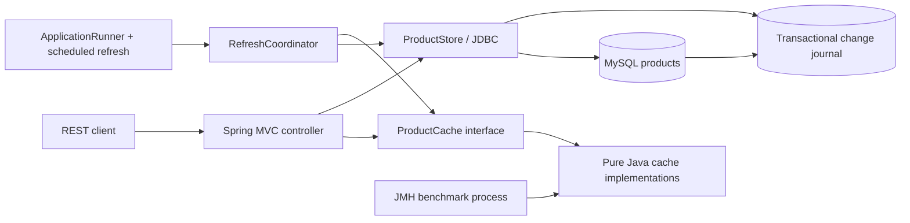

> Historical v0.1 documentation. For the expanded repository use [README.md](README.md). Commands and release scope below describe the original Spring cache edition.

# Backend Engineering Lab

**v0.1.0 — Product Cache & Incremental Synchronization**

A local engineering and learning laboratory for investigating caching, concurrency, data consistency and performance in backend applications. The first edition is implemented in Java 25 and Spring Boot 4.2.0. Future editions can reproduce the same experiments using Jakarta EE and ASP.NET Core, without making them interdependent services.

> **Validation status:** source implementation is provided. Dependency-free Java checks passed on JDK 21 in the authoring environment. A full Java 25 Maven build, MySQL/Testcontainers run, Docker deployment and JMH performance run have not been executed there. This is not a verified production release. See [validation status](docs/VALIDATION_STATUS.md) before presenting any result.

## 1. Motivation and original problem

Consider a product catalogue with 100,000 database records. Reading the entire catalogue from the database for every request creates avoidable work. Loading it into application memory makes repeated reads independent of the database, but introduces a different class of problems: how to refresh the cache without missing updates, how to serve readers while refreshing it, and how to make performance claims without sacrificing correctness.

The source exercise asks for a product containing `Id`, `Name` and nullable `LastUpdatedTime`, an initial cache load at application startup, a periodic incremental database refresh, and pagination of 10 products. It also explicitly mentions newly inserted records whose `LastUpdatedTime` is null. The original exercise requested an MVC page and optionally client-side filtering. This laboratory adapts the exercise into a REST-based backend experiment: server-side search and pagination are implemented; the original rendered MVC page and client-side search are deliberately outside v0.1.

The purpose is not to declare one framework or cache universally faster. It is to reproduce a problem, explain its correctness guarantees, implement alternatives, test those alternatives and measure their costs under controlled conditions.

### Research questions

- Does a thread-safe collection also provide a consistent view of an entire catalogue refresh?
- When does one global lock become a bottleneck? What does it protect that a concurrent map does not?
- What are the allocation and memory costs of an immutable snapshot?
- Why can a timestamp-only query miss a new product? Why is an increasing ID not a commit-order guarantee?
- Can a single cache consumer recover missed change notifications without relying on a maximum ID watermark?
- What is the difference between a functional correctness test, a microbenchmark and an HTTP load test?
- Why does sharing a singleton cache require both an appropriate lifetime and safe access to its mutable state?

## 2. Release scope

| Included in v0.1 | Intentionally deferred |
|---|---|
| Spring Boot 4.2.0, Java 25, Maven reactor | Java 17/25 runtime comparison and virtual threads |
| MySQL 8.4, JDBC, SQL schema, deterministic seed | Jakarta EE and ASP.NET Core ports |
| Startup loading of 100,000 immutable products | Production migration strategy and multi-instance coordination |
| Five cache strategies and a common interface | Redis, distributed invalidation, eviction and cache stampede |
| ID/timestamp baseline and single-consumer change journal | CDC, broker, multi-consumer offsets and outbox delivery |
| Periodic refresh and optional local manual refresh | Extended failure injection, SLOs and formal load testing |
| REST CRUD, 10-row default pagination, server-side search | React, JSF, MVC view, authentication and deployment to public networks |
| JUnit, controlled race demonstration, MySQL integration test source | k6, JFR, OpenTelemetry, Grafana and cross-framework rankings |
| JMH read-only and mixed-reader/writer benchmark, report runner | Measured benchmark conclusions until the run is performed |

This is a single-deployment local application, not a microservice architecture. All product writes persist to MySQL first; the cache is an eventually consistent read projection. There is no direct cache update on HTTP writes, because the periodic refresh is the behaviour under study.

## 3. Architecture



The cache algorithms are in a small, framework-independent Maven library. Spring Boot wires one cache instance through dependency injection. JMH uses the same library directly without starting Spring or MySQL. This avoids benchmarking a second, subtly different implementation.

| Module | Purpose |
|---|---|
| `implementations/spring-boot/cache-core` | Product model, cache interface, five strategies, pagination and watermark logic |
| `implementations/spring-boot/app` | HTTP endpoints, JDBC repository, startup, scheduler, journal, dependency injection |
| `implementations/spring-boot/benchmarks-jmh` | Isolated cache microbenchmarks |
| `labs/01-product-cache` | Experiment questions and qualitative evaluation |
| `shared/contracts` | Portable HTTP contract for future framework ports |
| `tools` | Offline checks, HTTP smoke test and JMH result runner |
| `docs` | Architecture, synchronisation, testing, API and roadmap |
| `reports` | Validation evidence and local benchmark results (generated results are ignored by Git) |

See [architecture and developer guide](docs/ARCHITECTURE.md) for the source-code flow, dependencies and extension points.

## 4. Cache strategies

All strategies implement the same `ProductCache` interface, share immutable product values and use the same filtering/pagination algorithm. The active strategy is selected at startup. It is not switched while requests are in flight.

| Strategy | Individual concurrent access | Atomic batch visibility / single page | Main trade-off |
|---|---|---|---|
| `unsafe` — HashMap | Not guaranteed | No | Deliberately broken teaching control; lab profile required |
| `synchronized` — global monitor | Yes | Yes | Readers and writers contend for one monitor |
| `concurrent` — ConcurrentHashMap | Yes | No | Readers can see partially applied batches |
| `snapshot` — immutable map + AtomicReference | Yes | Yes | Copying the full map on each nonempty batch costs memory and CPU |
| `caffeine` — Caffeine cache | Yes | No | Library abstraction; eviction disabled to retain every product |

"Yes" for a page means it observes one cache state, not that successive HTTP pages see one common snapshot. All strategies may serve data that is behind MySQL. Thread safety, cache freshness and transaction isolation are three separate concepts.

The default is `snapshot` because this read-oriented example explicitly values consistent page reads during refresh. This is a design choice, not a measured claim that snapshots are fastest. `synchronized` also provides batch atomicity. `concurrent` and `caffeine` remain valid alternatives when weak batch consistency is acceptable.

The page implementation filters and sorts in memory on each call for a shared experimental baseline. That is not an optimal million-record browsing algorithm; precomputed indexes or a sorted snapshot would be separate experiments. JMH v0.1 measures keyed access and batches, not pagination throughput.

## 5. Synchronisation approaches

### Baseline: ID and timestamp watermark (lab-only)

```sql
SELECT id, name, last_updated_time
FROM products
WHERE id > :lastKnownId
   OR last_updated_time >= :lastObservedTimestamp;
```

The ID condition captures ordinary new rows with null timestamps. The inclusive timestamp condition replays ties. However, a transaction that receives a lower ID and commits after a higher ID can be missed. Hard deletes and arbitrary timestamp resets are not detectable by this query. This variant is intentionally limited and only enabled with the `lab` profile.

### Default: single-consumer change journal

Three MySQL triggers append product IDs to a durable journal in the same transaction as inserts, updates and deletes. The refresh worker reads a bounded set of visible journal entries, reads the corresponding current product states in a consistent database transaction, updates the selected cache, then deletes exactly those journal entries. It never assumes that a higher change ID implies earlier IDs have committed.

Startup loads a complete consistent snapshot and acknowledges only the journal IDs visible in that same snapshot. A single writer lock prevents a scheduled refresh from overlapping a manual one. If a refresh fails, the scheduler logs the error and retries at the next interval; journal replay is idempotent. The memory publication and database acknowledgement are not an atomic distributed transaction, and this is not an exactly-once delivery mechanism.

The journal assumes **one active cache consumer per database**, immutable product IDs and normal SQL INSERT/UPDATE/DELETE operations. TRUNCATE and disabling triggers are unsupported. The baseline and journal are discussed in detail in [SYNCHRONIZATION.md](docs/SYNCHRONIZATION.md), including late commit and restart limitations.

## 6. Quick start — Docker Desktop

Prerequisites: Docker Desktop (Linux containers) or Docker Engine with Compose v2, internet access for image/dependency downloads, enough memory for MySQL and the build. No local Maven installation is required for this route.

From the extracted repository root, in PowerShell:

```powershell
Copy-Item .env.example .env
docker compose up -d --build
docker compose logs -f app
```

Wait until the application logs `Cache initialized: 100000 products`. The web server may accept connections before startup loading completes; catalogue requests return HTTP 503 until the cache is ready. Press Ctrl+C to stop following logs (the containers remain running).

```powershell
Invoke-RestMethod http://localhost:8080/api/cache/status
Invoke-RestMethod 'http://localhost:8080/api/products?page=1&size=10'
Invoke-RestMethod 'http://localhost:8080/api/products?page=1&search=Product%20100'
```

The same GET URLs can be opened in a browser. Responses are JSON, not a rendered MVC page. See [API examples](docs/API.md) for Linux/macOS commands and error handling.

### Try the null timestamp requirement

```powershell
$new = Invoke-RestMethod -Method Post -Uri 'http://localhost:8080/api/products' -ContentType 'application/json' -Body '{"name":"New product with null timestamp"}'
$new.id
# The database insert has committed. The cache may not see it yet.
Start-Sleep -Seconds 12
Invoke-RestMethod "http://localhost:8080/api/products/$($new.id)"
```

A normal idle refresh should pick up the insert. If there is a journal backlog, more than one tick may be required; inspect `/api/cache/status`. The returned record should still have `lastUpdatedTime: null`. Rename the product to assign a database UTC timestamp:

```powershell
Invoke-RestMethod -Method Put -Uri "http://localhost:8080/api/products/$($new.id)" -ContentType 'application/json' -Body '{"name":"Renamed product"}'
Start-Sleep -Seconds 12
Invoke-RestMethod "http://localhost:8080/api/products/$($new.id)"
```

### Select a different strategy

Edit `.env`, for example:

```dotenv
LAB_CACHE_STRATEGY=concurrent
LAB_SYNC_STRATEGY=journal
SPRING_PROFILES_ACTIVE=default
```

Then recreate the application container (the database persists):

```powershell
docker compose up -d --force-recreate app
```

For the deliberate unsafe/baseline experiments, use an isolated local database and set `SPRING_PROFILES_ACTIVE=lab`, `LAB_CACHE_STRATEGY=unsafe` or `LAB_SYNC_STRATEGY=watermark`. Both unsafe cache and watermark sync are rejected without this profile. Manual refresh is available only with the lab profile:

```powershell
Invoke-RestMethod -Method Post -Uri 'http://localhost:8080/lab/cache/refresh'
```

To stop the application without deleting the database, run `docker compose down`. **Destructive reset:** `docker compose down -v` removes the local data volume and all products. Only use it on disposable lab data. Seed count is applied only on the first initialization of an empty, unseeded database; changing it later does not resize an existing catalogue.

## 7. Build and run tests locally

Install JDK 25, Maven 3.9.x and Docker. Run from the repository root:

```powershell
java -version
mvn -version
# Unit tests only; no Docker required
mvn -B -f implementations/spring-boot/pom.xml test
# Full build, JUnit and Testcontainers (Docker must be running)
mvn -B -f implementations/spring-boot/pom.xml verify
```

The integration test starts its own disposable MySQL 8.4 container and embedded HTTP server. It checks the original null-timestamp case, actual REST calls, rename/delete refresh, rollback and the late-commit failure of the watermark method. It does not use the running Compose database. Maven `test` alone does not run `*IT`; `verify` does.

A portable subset can be exercised without external dependencies (JDK 21+, Python 3):

```powershell
python tools/check_offline.py
```

This is a separate harness, not a substitute for the full test suite or Java 25 build. See [TESTING.md](docs/TESTING.md) for assertions, repeatability, CI and the expected distinction between a passing negative experiment and a production-safe implementation.

## 8. Run JMH and generate a real report

Build the benchmark module (from the root, JDK 25 and Maven):

```powershell
mvn -B -f implementations/spring-boot/pom.xml -pl benchmarks-jmh -am clean package
python tools/run_benchmark.py --smoke --count 10000
python tools/run_benchmark.py --count 100000 --note 'Record CPU model, RAM, power mode, and workload conditions here'
```

The smoke run is a wiring check, not publishable evidence. The normal runner starts separate JMH runs for read-only (four reader threads) and mixed workloads (four readers and one writer updating 16 products per batch). Each variant uses two forks, warmup and measurement iterations, the same heap settings and a deterministic key trace. It also collects GC allocation metrics.

No database, Docker or HTTP server needs to be running during these microbenchmarks. Stop unrelated local services when measuring. Results are saved under `reports/runs/<timestamp>/`:

- `readOnly.json`, `mixed.json` — unmodified JMH result files;
- `environment.json` — commands, runtime, host information, Git state, artifact hash and completion status;
- `REPORT.md` — generated measured table, with separate reader and writer scores where present.

**There are no measured performance numbers bundled in this release.** The qualitative [evaluation](labs/01-product-cache/EVALUATION.md) is based on the design and explicitly separated from executed tests. The runner is prepared to produce empirical results after a successful Java 25 build. See [BENCHMARKS.md](docs/BENCHMARKS.md) for metric interpretation and how to rerun a fair experiment.

## 9. Local safety and operational boundaries

This is a private learning lab, not a public e-commerce service. The app binds to loopback by default; Compose publishes the port only on `127.0.0.1`. MySQL is not published to the host. Local example credentials are not production secrets. There is no authentication, authorization, TLS, rate limiting, multi-instance journal consumer or externally exposed admin API. The `lab` profile enables deliberately unsafe behaviour. Do not expose it to a network or use a real customer database.

Health is available via `/actuator/health`; cache readiness and refresh observations are available via `/api/cache/status`. These are basic local diagnostics, not an observability stack. A successful last refresh timestamp does not guarantee that a backlog has drained or that the baseline has not lost an update.

## 10. Reading order and future work

1. [Architecture and developer guide](docs/ARCHITECTURE.md)
2. [Data synchronisation and correctness](docs/SYNCHRONIZATION.md)
3. [API contract and examples](docs/API.md)
4. [Testing and reproducibility](docs/TESTING.md)
5. [Benchmark methodology](docs/BENCHMARKS.md)
6. [Lab 01 evaluation](labs/01-product-cache/EVALUATION.md)
7. [Validation status](docs/VALIDATION_STATUS.md)
8. [Roadmap](docs/ROADMAP.md)

The next releases can add controlled stock-reservation races, asynchronous I/O, Java 17/25 platform and virtual thread experiments, multicore CPU work, DI lifetimes, domain events and later Jakarta EE/.NET ports. Each new release should have a small, runnable scope. The monorepo will share specifications and fixtures, not force unrelated framework implementations into a distributed runtime.

## References

- [Spring Boot 4.2 release announcement](https://spring.io/blog/2026/11/19/spring-boot-4-2-0-available-now/) and [system requirements](https://docs.spring.io/spring-boot/system-requirements.html)
- [Java 25 ConcurrentHashMap API](https://docs.oracle.com/en/java/javase/25/docs/api/java.base/java/util/concurrent/ConcurrentHashMap.html)
- [Java 25 AtomicReference API](https://docs.oracle.com/en/java/javase/25/docs/api/java.base/java/util/concurrent/atomic/AtomicReference.html)
- [Caffeine documentation](https://github.com/ben-manes/caffeine/wiki)
- [MySQL 8.4 trigger syntax](https://dev.mysql.com/doc/refman/8.4/en/create-trigger.html)
- [MySQL 8.4 InnoDB consistent reads](https://dev.mysql.com/doc/refman/8.4/en/innodb-consistent-read.html)
- [OpenJDK JMH](https://github.com/openjdk/jmh)
- [Testcontainers for Java](https://java.testcontainers.org/)

The code is a new educational implementation of the described exercise, not a reproduction of an employer's proprietary system. No production or personal data is included.
