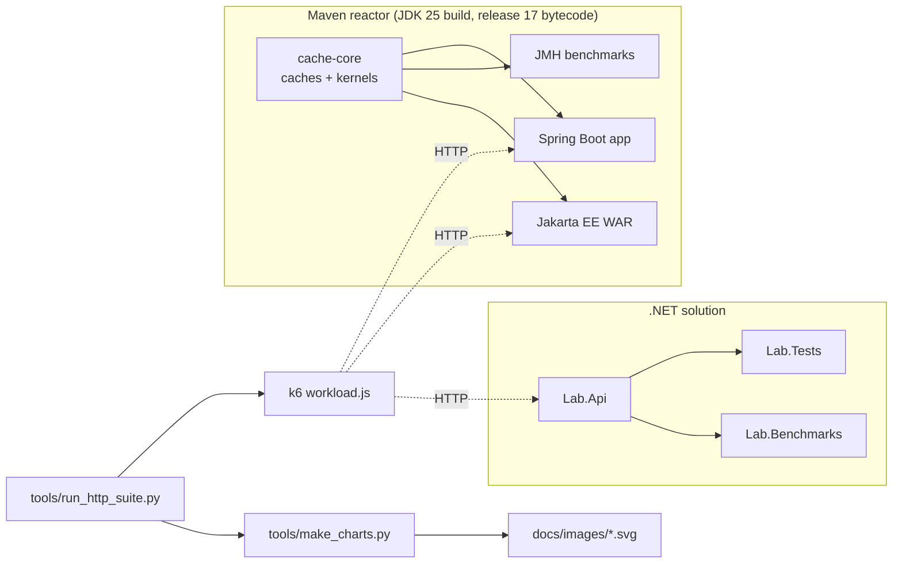

# Developer guide

## 1. Repository layout

```text
implementations/spring-boot/cache-core/     Pure Java cache strategies + experiment kernels (shared by Spring and Jakarta)
implementations/spring-boot/app/            Spring Boot 4.2: controllers, JDBC, scheduler, events, Redis, DB pool, DI labs
implementations/spring-boot/benchmarks-jmh/ JMH benchmarks against the shared kernels
implementations/jakarta-ee/                 Jakarta EE 11 WAR for WildFly 42: JAX-RS, CDI, JTA datasources, managed executors, Redis (Jedis)
implementations/aspnet-core/Lab.Api/        ASP.NET Core minimal API (.NET 10/11), ADO.NET, outbox, DI labs, Redis (StackExchange.Redis)
implementations/aspnet-core/Lab.Tests/      xUnit tests for the .NET kernels
implementations/aspnet-core/Lab.Benchmarks/ BenchmarkDotNet (CPU, reservation)
labs/NN-*/README.md                         one document per lab: problem, concepts, code, tests, benchmarks, results
benchmarks/k6/workload.js                   the one k6 script used by every HTTP experiment
infrastructure/mock-api/server.py           deterministic slow upstream (100/200/300 ms)
tools/                                      suite runner, chart generator, smoke tests, offline checks
reports/                                    raw benchmark data + BENCHMARK_REPORT.md
docs/                                       guides, methodology, validation status, roadmap, images/ (generated charts)
observability/                              OTel collector, Prometheus, Tempo, Grafana provisioning
```



## 2. Tools

| Tool | Purpose |
|---|---|
| `tools/run_http_suite.py` | Starts one backend configuration at a time (Docker Compose, CPU/memory limits), runs k6 warm-up + measured runs (optionally repeated), runs functional probes, writes `reports/http-runs/<UTC>/`. `--list`, `--only <prefix>` |
| `tools/run_benchmark.py` | JMH runner (`--suite cache\|engineering\|all`), writes `reports/runs/<UTC>/` |
| `tools/make_charts.py` | Regenerates every chart in `docs/images/` from the raw files (light + dark SVG) |
| `tools/compare_http.py` | Common HTTP contract test for any edition (`--url`) |
| `tools/smoke_api.py` | Spring CRUD + refresh smoke test |
| `tools/check_offline.py`, `tools/check_extended.py` | Dependency-free Java checks (compile and run with the local JDK) |
| `tools/redis_lab.py` | Standalone Redis TTL demonstration (two raw clients) |

## 3. Framework differences that matter for the labs

| Concern | Spring Boot | Jakarta EE (WildFly) | ASP.NET Core |
|---|---|---|---|
| Request threads | Tomcat pool (200) or virtual threads (`spring.threads.virtual.enabled`) | Undertow worker pool (16 × CPUs) | Kestrel + .NET ThreadPool (grows slowly when threads block) |
| Background work | `ExecutorService` beans, `@Async`, `@Scheduled` | `ManagedExecutorService` / `ManagedScheduledExecutorService` (container-managed; Concurrency 3.1 adds `virtual=true`) | `BackgroundService`, `Task`, `Parallel.For` |
| Scopes | singleton, prototype, request, session (scoped proxies) | `@ApplicationScoped`, `@RequestScoped`, `@Dependent` (client proxies for normal scopes) | singleton, scoped, transient (no proxies) |
| Who destroys short-lived objects | **not** prototypes – the caller owns them | `@Dependent` objects live as long as their owner; `Instance.get()` needs `destroy()` | scoped/transient `IDisposable` are disposed with the scope that created them – the root scope lives until shutdown |
| Wrong-scope detection | scoped proxy makes request beans safe to inject into singletons; prototype-in-singleton is silently captured | normal scopes are proxied (safe); `@Dependent` is captured by its owner | `ValidateScopes` throws only in Development; in Production a scoped service resolved from root silently becomes a singleton |
| Transactions | `@Transactional` on JDBC (`DataSourceTransactionManager`) | JTA (`@Transactional`, container datasources) | explicit `MySqlTransaction` |
| After-commit work | `@TransactionalEventListener(AFTER_COMMIT)` | `@Observes(during = AFTER_SUCCESS)` | outbox table + `BackgroundService` |
| Redis client (Lab 08) | Lettuce via Spring Data Redis: one shared, multiplexed connection | Jedis 8 `RedisClient`: one pooled connection per command (`REDIS_POOL_MAX`, default 8) | StackExchange.Redis: one multiplexed connection, async API |

## 4. Adding an experiment

1. Write the invariant and the workload in the lab README first.
2. Keep algorithms server-independent where possible (`cache-core`), and pass container-managed executors in.
3. Add a local-only `/lab/...` route with input bounds. Never enable negative modes outside the lab profile.
4. Add a correctness check (unit test, `compare_http.py` assertion or suite probe) **before** any benchmark.
5. Add a k6 experiment or probe to `tools/run_http_suite.py`, run it, keep the raw output, regenerate charts with `tools/make_charts.py`.
6. Update the lab README, [BENCHMARK_REPORT.md](../reports/BENCHMARK_REPORT.md), [VALIDATION_STATUS.md](VALIDATION_STATUS.md) and [ROADMAP.md](ROADMAP.md).

This is one monorepo with independently deployable editions, not a microservice system. The original Spring cache design is in [ARCHITECTURE.md](ARCHITECTURE.md).
