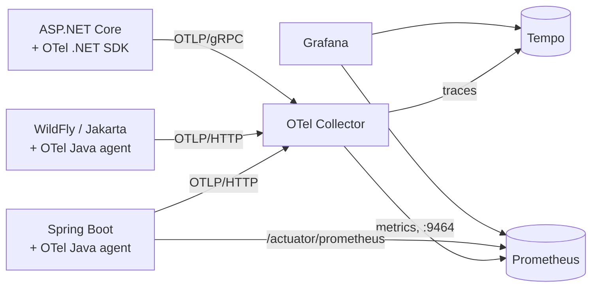

# Observability

The labs do not depend on monitoring; it is an optional overlay. **Ingestion of metrics and traces was verified for all three editions on 2026-11-27**: [validation record](../reports/observability/2026-11-27-validation.md).



## Start

1. Download the official OpenTelemetry Java agent from https://github.com/open-telemetry/opentelemetry-java-instrumentation/releases, check its checksum and save it as `observability/agent.jar` (git-ignored). Validated with **2.34.0**.
2. Start one backend with the overlays:

```powershell
# Spring Boot
docker compose -f docker-compose.yml -f docker-compose.monitoring.yml -f docker-compose.otel-java.yml up -d --build app mock-api otel-collector prometheus tempo grafana
# Jakarta EE (same agent)
docker compose -f docker-compose.yml -f docker-compose.monitoring.yml -f docker-compose.otel-java.yml --profile jakarta up -d --build jakarta mock-api otel-collector prometheus tempo grafana
# ASP.NET Core (SDK, enabled by OTEL_EXPORTER_OTLP_ENDPOINT)
docker compose -f docker-compose.yml -f docker-compose.monitoring.yml -f docker-compose.otel-dotnet.yml --profile dotnet up -d --build dotnet mock-api otel-collector prometheus tempo grafana
```

Grafana http://localhost:3000 (admin / `local-grafana-password`, local only), Prometheus http://localhost:9090. Tempo has no published port; use Grafana Explore or the datasource proxy.

## What to expect

| Signal | Where | Names |
|---|---|---|
| Spring Micrometer metrics | Prometheus job `spring` | `http_server_requests_seconds_*`, `jvm_*` |
| OTel metrics (all editions) | Prometheus job `collector`, label `exported_job=backendlab-{spring,jakarta,dotnet}` | `http_server_request_duration_seconds_*`, `http_client_request_duration_seconds_*` |
| Traces | Tempo, `service.name = backendlab-*` | e.g. `GET /lab/io/{mode}` with three client `GET` spans |

The first OTel metrics appear within about a minute (default export interval 60 s). Example TraceQL: `{ resource.service.name = "backendlab-dotnet" && span.http.route = "/lab/io/{mode}" }`.

The provisioned dashboard "Backend Lab — Spring baseline" uses Spring's Micrometer names only; for Jakarta and .NET use Explore (no dedicated dashboards). No log pipeline is configured.

## Profiling

JFR: `jcmd <pid> JFR.start name=lab settings=profile duration=60s filename=lab.jfr`. A thread dump that includes **virtual threads** needs `jcmd <pid> Thread.dump_to_file -format=plain <file>` (a classic `jstack`/`kill -3` dump shows only carrier threads); this is how the WildFly executor limit was found. On .NET use `dotnet-counters` / `dotnet-trace` against a process with the diagnostic tools installed. The runtime-only images may not contain these tools; WildFly's image includes a JDK and `jcmd`.

Benchmarks in [the report](../reports/BENCHMARK_REPORT.md) were run **without** instrumentation; the agent's overhead was not measured.
