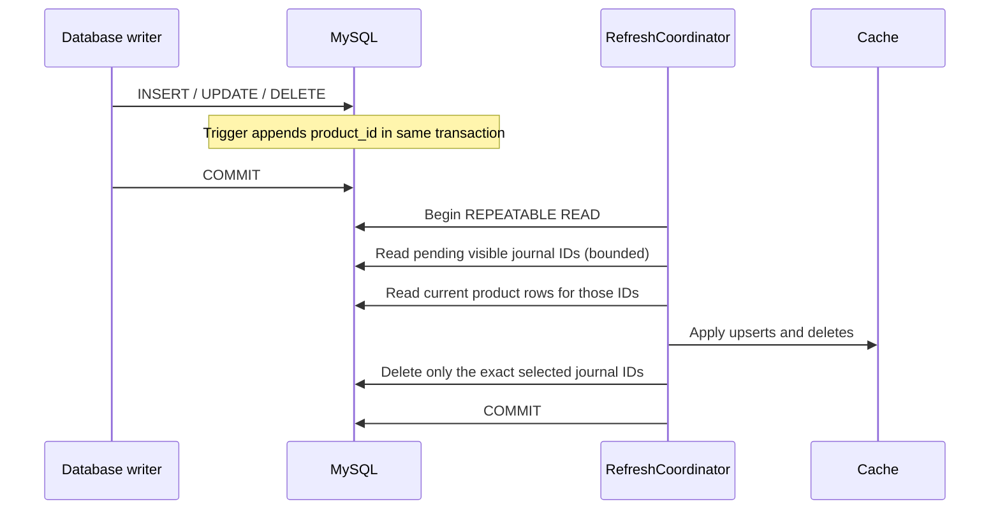

> Scope: original Spring Boot cache edition (v0.1). For the expanded implementation, see the [root README](../README.md), [coverage](ROADMAP.md) and [extended protocol](EXPERIMENT_PROTOCOL.md).

# Incremental synchronisation: what is guaranteed?

## Product schema and timestamps

The original public model contains `id`, `name`, and nullable `lastUpdatedTime`. `products.last_updated_time` is `DATETIME(6)`. The JDBC URL and row mapping use UTC; the application sets `UTC_TIMESTAMP(6)` on rename and leaves the insert timestamp null. External writers are assumed to use UTC when setting this column.

A timestamp condition alone is insufficient because SQL comparisons against NULL do not evaluate to true. A common improvement is to use an ID watermark alongside the timestamp. This works for straightforward inserts and updates, not for arbitrary concurrent transactions.

## Counterexample: late commit

```text
Initial highest visible product ID = 100000
Transaction A inserts product 200001, timestamp NULL, does not commit.
Transaction B inserts product 200002, timestamp NULL, commits.
Refresh sees 200002; max-ID watermark moves to 200002.
Transaction A commits.
Next refresh requires id > 200002 OR timestamp >= watermark.
200001 is smaller and its timestamp is NULL: row is missed.
```

Using `>=` for timestamps prevents losing exact ties at the watermark but does not solve late commits with older timestamps, or hard deletes. Re-reading a bounded time window reduces certain risks but cannot guarantee completeness with unbounded delays. The baseline in `ProductStore.after` uses `Watermark.advance` only after applying the rows. Its inclusive time boundary can reread rows repeatedly; an intentional trade-off.

`CatalogIT` contains the above real MySQL transaction schedule. It asserts that the baseline misses the late row and the journal consumer receives it. This test has been authored but not executed in the authoring environment.

## Journal design



Each trigger writes `product_id` to `product_changes`. `change_id` is the primary key used to identify a notification. It is not a commit-order cursor. The journal stores no payload; when a batch is consumed, the worker coalesces the affected product IDs and reads their current state within the same repeatable-read transaction. A missing product row becomes a deletion. Updates to different product IDs can be combined. Intermediate historical values are not preserved; this is a current-state cache, not an audit log.

### Why a later commit is not lost

A refresh consumes only committed rows visible in its consistent read. If change ID 12 commits before change ID 11, deleting 12 does not delete 11. Once 11 commits it remains pending and will be picked up by a subsequent refresh. The worker does not delete a range of IDs or advance a maximum change-ID cursor.

### Startup protocol

The app seeds once, then opens a repeatable-read transaction. It reads the complete products table and the visible journal IDs. It publishes the cache and acknowledges only those exact IDs. Changes committed after the consistent read remain pending. It sets readiness only after the transaction returns successfully.

### Failure semantics

- A database failure before applying changes leaves the prior safe cache state available. A scheduled failure is logged and retried on a later tick.
- If memory publication succeeds but acknowledgement/commit fails, the same notification can be read again. Upserts and deletes are idempotent; the worker re-reads current DB state. The state may already have advanced in memory even if the reported refresh failed.
- If the process dies, the cache dies with it. Restart reconstructs the cache from MySQL before serving catalogue reads.
- If the cache strategy fails partway through application, the journal transaction is not acknowledged. A partial state can be visible with weak or unsafe strategies; the default snapshot constructs the next map before publishing it.
- The journal is not a durable audit trail; acknowledged notifications are deleted. The implementation is not exactly-once and does not make memory and database one transaction.

### Explicit limitations

Only one active cache consumer may acknowledge a given database journal. Two independent consumers would remove notifications needed by the other. Running multiple application instances against the same database is unsupported. Multi-consumer delivery would require per-consumer state, a separate durable event system or CDC, plus lifecycle/reconciliation rules.

Only normal insert/update/delete operations with an immutable primary key are covered. TRUNCATE, changing IDs, bypassing or disabling triggers and restoring an inconsistent database snapshot are out of scope. Trigger overhead, journal growth under heavy write workloads, batch tuning, long startup transactions and database failure injection require further experiments. Baseline mode does not consume the journal during regular refresh, so pending rows accumulate until a fresh startup (or an intentional local reset). Do not run that mode indefinitely.

The fixed-delay scheduler processes up to `LAB_BATCH_SIZE` journal notifications per tick. Large backlogs can exceed the nominal refresh interval; the app does not claim bounded staleness. The reported changed count is unique affected products, not number of journal entries. Last successful refresh time is an observation, not proof that all writes have been reflected.

## Test design

Separate source/DB correctness from cache publication correctness. A concurrent map cannot fix a missing database update; a perfect journal cannot make a weakly consistent page atomic. Validate both independently and then together. See `CatalogIT` and `CacheContractTest`.
