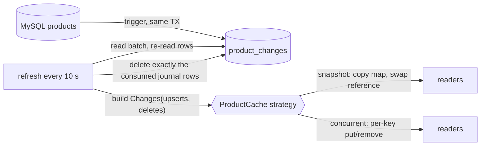
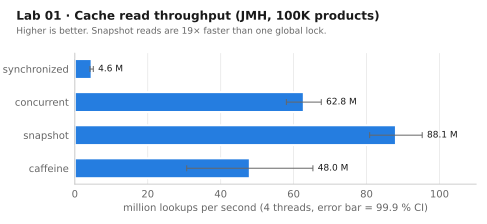
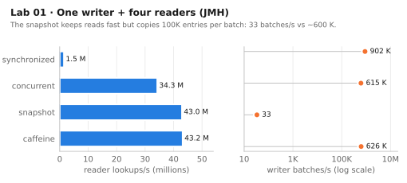

# Lab 01 — Product cache and incremental synchronization

> **Use case:** show a 100,000-product catalogue, 10 at a time, from memory, while a background job keeps it in sync with MySQL.
> Related: [EVALUATION.md](EVALUATION.md) (design discussion), [SYNCHRONIZATION.md](../../docs/SYNCHRONIZATION.md) (journal vs watermark), [benchmark report](../../reports/BENCHMARK_REPORT.md).

## 1. Problem and why it matters

Reading a catalogue from memory is fast, but two hard questions remain:

1. **Which changes must the refresh apply?** Newly inserted rows have `lastUpdatedTime = NULL`, and IDs and timestamps are assigned *before* commit. A naive "newer than the last watermark" query misses rows.
2. **How are changes published to readers that are reading right now?** A reader must never see a broken structure. Depending on the requirements, it may also need to see a *whole* batch or none of it.

## 2. Concepts

| Concept | Meaning |
|---|---|
| Thread safety vs atomicity | a concurrent map makes each `get`/`put` safe; a batch of 16 updates is still visible in stages |
| Safe publication | readers see either the old or the new fully built object (immutable snapshot + volatile reference) |
| Copy-on-write | writers copy the whole structure, readers never lock |
| Change journal | triggers write every change to `product_changes` in the same transaction; the consumer acknowledges exactly what it read |
| Staleness | time between a committed change and the cache serving it |

## 3. Incorrect and correct implementations

| Strategy | Java ([cache-core](../../implementations/spring-boot/cache-core/src/main/java/de/backendlab/cache/), Spring + Jakarta) | .NET (`Catalog` in [Program.cs](../../implementations/aspnet-core/Lab.Api/Program.cs)) | Guarantee |
|---|---|---|---|
| `unsafe` ✖ | `HashMap`, no lock | `Dictionary`, no lock | none (data race; negative example) |
| `synchronized` | one monitor for reads and writes | `lock` | atomic pages, readers block each other |
| `concurrent` | `ConcurrentHashMap` | `ConcurrentDictionary` | per-key safety only |
| `snapshot` (default) | `AtomicReference<Map>` of an immutable copy | `ImmutableDictionary` + `Interlocked.Exchange` | atomic pages, lock-free reads, full copy per batch |
| `caffeine` / `library` | Caffeine without eviction | `IMemoryCache` + key set | per-key safety |

Change detection: `journal` (default, correct), `watermark` (deliberately limited baseline that misses late commits), `full` (ports only). The refresh is serialized by a writer lock: `RefreshCoordinator` in Spring, `synchronized refresh()` in Jakarta, `SemaphoreSlim` in .NET.

## 4. Framework differences

| | Spring Boot | Jakarta EE | ASP.NET Core |
|---|---|---|---|
| scheduler | `@Scheduled` | `ManagedScheduledExecutorService` | `BackgroundService` + `PeriodicTimer` |
| data access | Spring JDBC | plain JDBC | ADO.NET (MySqlConnector), async |
| cache code | shared `cache-core` | same `cache-core` | own implementation |
| page building | stream filter + sort of all entries | same | LINQ over `ImmutableDictionary.Values` (a tree) copied into an array |

## 5. Correctness tests

- `CacheContractTest` (all five strategies: seed, pagination, search, insert/update/delete, immutability; atomic page under concurrent writes for `synchronized`/`snapshot`), `RaceConditionTest`, `WatermarkTest`.
- `CatalogIT` (Testcontainers MySQL): HTTP pagination, NULL-timestamp insert, rename, delete, **late commit missed by the watermark and caught by the journal**, rollback.
- `compare_http.py` / `smoke_api.py`: pagination and NULL-timestamp insert on every edition.
- Probe `staleness`: rename product 77, poll until the cache serves it (5 samples per edition).

## 6. Benchmark methodology

| Benchmark | Setup |
|---|---|
| JMH `CacheBenchmark.readOnly` | 4 threads, `get(id)` for pseudo-random ids, 100K products, 2 forks × 5 × 2 s, `-prof gc` |
| JMH `CacheBenchmark.mixed` | 4 readers + 1 writer applying 16-product batches as fast as possible (stress case) |
| k6 `catalog-get` | `GET /api/products/42`, 2,000 req/s, 30 s warm-up + 30 s, 4 CPUs, 5 repetitions |
| k6 `catalog-page` | `GET /api/products?page=500&size=20`, 50 req/s |

## 7. Results

<picture><source media="(prefers-color-scheme: dark)" srcset="../../docs/images/lab01-jmh-read-dark.svg"></picture>

<picture><source media="(prefers-color-scheme: dark)" srcset="../../docs/images/lab01-jmh-mixed-dark.svg"></picture>

**JMH** — [run 20261126T194918342533Z](../../reports/runs/20261126T194918342533Z/REPORT.md):

| Strategy | read-only ops/s (± 99.9 % CI) | alloc B/op | mixed: reader ops/s | mixed: writer batches/s | GC time in mixed run |
|---|---:|---:|---:|---:|---:|
| synchronized | 4.61 M ± 0.46 M | 40 | 1.49 M | 902 K | 16 ms |
| concurrent | 62.8 M ± 4.8 M | 40 | 34.3 M | 615 K | 122 ms |
| **snapshot** | **88.1 M ± 7.2 M** | 16 | **43.0 M** | **33.4** | **2,163 ms** |
| caffeine | 48.0 M ± 17.3 M | 40 | 43.2 M | 626 K | 114 ms |

Caffeine's wide interval comes from two slow iterations (≈ 29 M) among otherwise 50–61 M; treat it as noisy.

**HTTP `catalog-get`, snapshot strategy, 5 repetitions** — median [min – max]:

| Edition | achieved req/s | p50 ms | p99 ms | source |
|---|---|---|---|---|
| Spring Boot | 1,999.9 [1,974 – 1,999.9] | 0.62 [0.48 – 0.79] | 5.16 [1.52 – 104.9] | [003011Z](../../reports/http-runs/20261127T003011Z/REPORT.md) |
| Jakarta EE | 1,987.5 [1,532 – 1,993] | 1.65 [1.43 – 562.9] | 218.0 [105.6 – 1,130.6] | [011057Z](../../reports/http-runs/20261127T011057Z/REPORT.md) |
| ASP.NET Core | 1,999.9 [1,989 – 2,000] | 0.93 [0.81 – 0.94] | 35.5 [21.4 – 54.4] | same |

**Strategies over HTTP** (Spring, single runs, [202650Z](../../reports/http-runs/20261126T202650Z/REPORT.md)):

| Strategy | catalog-get p50 / p99 | catalog-page p50 / p99 |
|---|---|---|
| synchronized | 0.87 / 47.6 | 10.5 / **120.8** |
| concurrent | 1.16 / 101.0 | 8.4 / 19.8 |
| snapshot | 1.02 / 79.2 | 7.9 / 17.8 |
| caffeine | 0.92 / 50.5 | 8.2 / 16.1 |

**Paging per edition** (snapshot, [222721Z](../../reports/http-runs/20261126T222721Z/REPORT.md)): Spring p50 6.2 / p99 12.1 ms (45 % CPU), Jakarta 8.5 / 15.0 ms (49 %), .NET **47.4 / 97.6 ms (261 % CPU)**.

**Staleness** (journal refresh every 10 s, phases `v3-*`, [011057Z](../../reports/http-runs/20261127T011057Z/REPORT.md)): Spring 3.2–8.3 s (median 5.0 s), Jakarta 3.2–8.3 s (5.4 s), .NET 3.2–8.3 s (4.9 s).

## 8. Interpretation and trade-offs

**Observations → explanations**
1. A global monitor caps reads at 4.6 M ops/s, 19× below the snapshot, because every `get` serializes. With a writer it drops another 3×.
2. The snapshot has the cheapest reads (one volatile read, immutable map) but copies 100K entries per batch: 33 batches/s and 2.2 s of GC per measurement window under continuous writes. With the real 10 s refresh that is one ~30 ms copy every 10 s, which is negligible.
3. Over HTTP the strategies are indistinguishable for single-key reads. The map lookup costs nanoseconds and HTTP + JSON about a millisecond; p99 differences between single runs are noise. Paging is different: `synchronized` holds the monitor during the ~8 ms sort, so concurrent page requests queue (p99 121 ms).
4. Jakarta at 2,000 req/s is near its 4-CPU capacity and **bistable**: 4 of 5 runs were fine (p50 ≈ 1.5 ms), one collapsed (p50 563 ms). An earlier single run (1,207 req/s) caught the bad side. The cause of the higher CPU per request on WildFly was not profiled.
5. .NET pages are 5–8× slower and CPU-heavy because every request copies the `ImmutableDictionary` (a balanced tree) into an array before sorting 100K entries.
6. Staleness is uniform in 0–10 s, as a 10 s polling refresh implies (median ≈ 5 s).

**Decision table**

| Need | Choose |
|---|---|
| consistent pages, rare refreshes, read-heavy | **snapshot** |
| frequent writes, per-product independence acceptable | concurrent (or Caffeine for eviction/TTL) |
| simplest correct code, low concurrency | synchronized |
| fresher data than "≤ refresh interval" | shorter interval, or write-through / explicit invalidation |

## 9. Limitations

- One JMH run per configuration. The HTTP strategy comparison is single-run. Paging uses one fixed page.
- Pages are sorted per request in every edition. A pre-sorted index published with the snapshot would remove that cost (listed in [ROADMAP.md](../../docs/ROADMAP.md)).
- No BenchmarkDotNet equivalent of the cache microbenchmarks.

## 10. Use cases and interview questions

- Product catalogues, reference data, feature flags, permission tables.
- *Why does `LastUpdatedTime > watermark` miss rows?* NULLs and late commits ([SYNCHRONIZATION.md](../../docs/SYNCHRONIZATION.md)).
- *ConcurrentHashMap or snapshot?* Per-key safety vs atomic view; cheap writes vs cheap reads.
- *How stale can the cache be?* Up to the refresh interval plus refresh time (measured median ≈ 5 s with 10 s polling).
