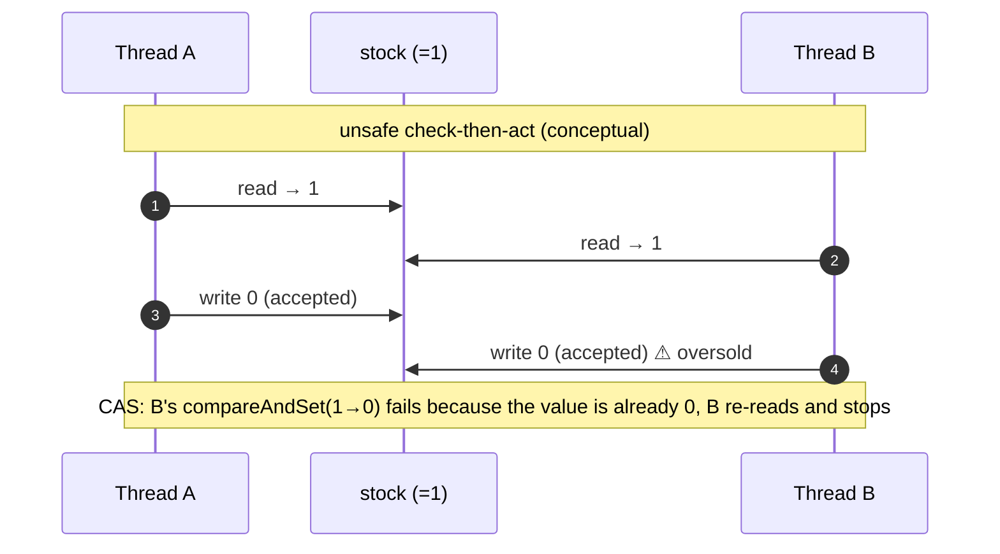
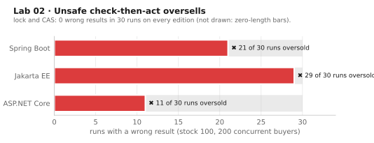

# Lab 02 — Race conditions and stock reservation

> **Use case:** a flash sale has 100 units and 200 customers press *Buy* at the same moment. Exactly 100 purchases may succeed and stock must never go negative.

## 1. Problem and why it matters

"If stock > 0 then stock -= 1" is a **check-then-act** sequence. Two threads can both read `1`, both pass the check and both decrement. The result is an oversell, which in a real shop means a refund, an angry customer or a broken ledger. These bugs rarely show up in single-user tests and appear under production load.

**Invariant (checked on every run):** `accepted == min(stock, requests)` and `remaining == max(0, stock − requests)`.

## 2. Concepts

| Concept | Meaning here |
|---|---|
| Race condition | the result depends on the timing of concurrent threads |
| Atomicity | the whole read-check-write happens as one indivisible step |
| Mutual exclusion (lock) | only one thread at a time may execute the critical section |
| Compare-and-set (CAS) | "set to *new* only if it is still *old*", retried until it succeeds; lock-free |
| Contention | many threads competing for the same lock or variable |

## 3. Incorrect and correct implementations

| Mode | Java ([Experiments.reserve](../../implementations/spring-boot/cache-core/src/main/java/de/backendlab/experiments/Experiments.java)) | .NET (`Lab.Reserve` in [Program.cs](../../implementations/aspnet-core/Lab.Api/Program.cs)) | Correct? |
|---|---|---|---|
| `unsafe` | read a plain `int`, `Thread.yield()`, write | read `int`, `Thread.Yield()`, write | ✖ lost updates |
| `lock` | `synchronized (lock) { check; decrement }` | `lock (gate) { … }` | ✔ |
| `atomic` | CAS loop on `AtomicInteger.compareAndSet(old, old − 1)` | `Interlocked.CompareExchange` loop | ✔ |

The `yield` widens the race window on purpose, so that the defect shows up in a lab instead of once a month in production.

## 4. Framework and runtime differences

| | Spring Boot | Jakarta EE | ASP.NET Core |
|---|---|---|---|
| how 2,000 attempts are scheduled | 2,000 `CompletableFuture`s on a fixed 32-thread pool | same kernel on the container's `ManagedExecutorService` | `Parallel.For` – a few ThreadPool workers run the loop body inline |
| lock primitive | intrinsic monitor (`synchronized`) | same | `Monitor` (`lock`) |
| CAS primitive | `AtomicInteger` | same | `Interlocked` |

Spring and Jakarta share the same Java kernel; only the executor differs.

## 5. Correctness tests

- Unit: `RaceConditionTest` (deterministic lost update with a barrier), `ExperimentTests.StockInvariant` (.NET), `tools/check_extended.py`.
- HTTP contract: `compare_http.py` asserts `correct: true` for `lock` and `atomic` on every edition.
- Probe: 30 runs per mode (stock 100, 200 concurrent requests) per edition in `run_http_suite.py`.

## 6. Benchmark methodology

> **Test machine (applies to every number in this lab):** one laptop, Intel Core i7-13700H (6 performance + 8 efficiency cores, 20 threads), 32 GB RAM, Windows 11 with Docker in WSL2. Each backend container is limited to 4 CPUs and 2 GB unless stated; k6, MySQL and the mock upstream run on the same machine. CPU quotas on a hybrid-core laptop are not pinned cores, and power/thermal management can shift results, so treat absolute numbers as environment-specific and compare only rows measured the same way. Details: [report §2](../../reports/BENCHMARK_REPORT.md#2-environment-and-method).

| Benchmark | Tool | Workload |
|---|---|---|
| kernel cost | JMH `EngineeringBenchmark.reserve`, BDN `ReservationBench` | one full experiment: stock 1,000, 2,000 attempts; 2 forks × 5 iterations (JMH), BDN default job |
| HTTP | k6, 50 experiments/s for 30 s (= 100,000 attempts/s), 4 CPUs | `reserve-atomic`, `reserve-lock` |

`unsafe` is never benchmarked: a fast wrong answer is not a result.

## 7. Results

<picture><source media="(prefers-color-scheme: dark)" srcset="../../docs/images/lab02-unsafe-dark.svg"></picture>

**Correctness** — run [20261126T222721Z](../../reports/http-runs/20261126T222721Z/REPORT.md), 30 runs per mode:

| Edition | unsafe: wrong runs | worst result (accepted of 100) | lock: wrong | atomic: wrong |
|---|---:|---:|---:|---:|
| Spring Boot | 21 / 30 | 150 | 0 / 30 | 0 / 30 |
| Jakarta EE | 29 / 30 | 144 | 0 / 30 | 0 / 30 |
| ASP.NET Core | 11 / 30 | 185 | 0 / 30 | 0 / 30 |

**Kernel cost** (stock 1,000, 2,000 attempts) — [JMH run](../../reports/runs/20261126T194918342533Z/REPORT.md), [BDN results](../../reports/bdn-runs/net10/results/ReservationBench-report-github.md):

| Mode | JMH, Java 25 | BDN, .NET 10 |
|---|---:|---:|
| atomic | 0.81 ± 0.11 ms (355 KB allocated) | 0.167 ± 0.005 ms (4.9 KB) |
| lock | 0.86 ± 0.10 ms (362 KB) | 1.039 ± 0.028 ms (6.5 KB) |

**HTTP**, 50 experiments/s, 4 CPUs, run 20261126T222721Z (ms):

| Edition | atomic p50 / p99 | lock p50 / p99 |
|---|---|---|
| Spring Boot | 1.62 / 3.53 | 1.75 / 3.28 |
| Jakarta EE | 4.15 / 8.34 | 4.35 / 8.68 |
| ASP.NET Core | 0.87 / 1.85 | 0.93 / 2.33 |

## 8. Interpretation and trade-offs

**Observations**
1. `unsafe` was wrong in 11–29 of 30 runs and oversold up to 85 %; `lock` and `atomic` were wrong in 0 of 180 runs.
2. In Java, `lock` and `atomic` cost the same (0.81 vs 0.86 ms). In .NET, CAS is 6× faster (0.17 vs 1.04 ms).

**Explanation (supported by the allocation numbers)**
- The Java experiment allocates ~180 bytes and one queue hand-off per attempt (355 KB per run). Task scheduling dominates, and the synchronization primitive disappears in the noise.
- `Parallel.For` runs the body inline on a few workers with almost no allocation (4.9 KB), so what remains really is contention. A contended `lock` spins and then blocks in the kernel; a failed CAS just retries.

**Conclusion:** both primitives are correct. "CAS is faster than locks" is true for the primitive and irrelevant when the overhead lies elsewhere, so measure the operation you care about. The failure rate of `unsafe` varies by executor (11 vs 29 of 30), which is why a race "that passed the tests" proves nothing.

| Approach | Use when | Limit |
|---|---|---|
| lock | invariants spanning several fields | blocks under contention; never hold it across I/O |
| CAS | one variable, conditional update | retry storms under extreme contention |
| database (`UPDATE … SET stock = stock − 1 WHERE id = ? AND stock > 0`) | **several application instances** | one round trip per reservation; hot-row contention (see Lab 07) |

## 9. Limitations

- Single process: with two application instances an in-memory lock protects nothing. The real-world answer is the database or a distributed coordinator, which is not implemented here.
- HTTP numbers come from one run per mode; kernel numbers have JMH/BDN confidence intervals.

## 10. Use cases and interview questions

- *Where else does check-then-act appear?* Seat booking, coupon redemption, rate-limit counters, "create user if not exists".
- *Why is a `ConcurrentHashMap` not enough for stock?* Each `get` and `put` is atomic, but the pair is not. Use `compute`/`merge` or a lock.
- *Lock or CAS?* Both are correct; choose by contention and by the shape of the invariant; measure.
- *How would you do this with 5 instances?* Conditional `UPDATE` in the database, or reservation tokens with idempotency keys.
