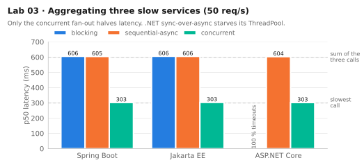

# Lab 03 — Blocking, sequential-async and concurrent I/O

> **Use case:** a product-detail page needs data from three independent services: product (100 ms), inventory (200 ms) and pricing (300 ms). How fast can it answer, and what does it cost in threads?

## 1. Problem and why it matters

Most backend latency is waiting on databases and other services. How a request waits decides two separate things: **latency** (how long one user waits) and **capacity** (how many requests can wait at the same time). Confusing "async" with "concurrent" is one of the most common performance mistakes, and in .NET mixing blocking with async can starve the whole server.

## 2. Concepts

| Concept | Meaning |
|---|---|
| Blocking I/O | the calling thread is parked until the response arrives |
| Non-blocking / async I/O | the thread registers a continuation and is free while waiting |
| Sequential async | `await a; await b; await c` – async, but the waits still add up |
| Concurrent async | start a, b and c, then await all – the waits overlap |
| Sync-over-async (.NET) | blocking on an async call (`.Result`, `.GetAwaiter().GetResult()`) |
| ThreadPool starvation | all pool threads are blocked, waiting for work that itself needs a pool thread |

Conceptual timeline (not measured) of one request:

```mermaid
gantt
  title One request, three upstream calls (conceptual)
  dateFormat  x
  axisFormat %L ms
  section Sequential (blocking or async)
  product   :0, 100
  inventory :100, 300
  pricing   :300, 600
  section Concurrent
  product   :0, 100
  inventory :0, 200
  pricing   :0, 300
```

## 3. Incorrect and correct implementations

| Mode | Code | Latency | Thread usage | Verdict |
|---|---|---|---|---|
| `blocking` | call → wait → call → wait → call | Σ = 600 ms | 1 thread blocked for 600 ms | correct, limited by thread count (Lab 04) |
| `sequential-async` | `thenCompose` / `await` in a loop | Σ = 600 ms | no thread while waiting | correct, but no latency gain |
| `concurrent` | `allOf` / `Task.WhenAll` | max = 300 ms | no thread while waiting | correct and fastest |
| .NET `blocking` (sync-over-async) | `GetStringAsync(...).GetAwaiter().GetResult()` | – | blocks a pool thread **and** needs one for the continuation | ✖ anti-pattern |

Code: `Experiments.io` ([Experiments.java](../../implementations/spring-boot/cache-core/src/main/java/de/backendlab/experiments/Experiments.java)) for Spring and Jakarta (JDK `HttpClient.send`/`sendAsync`, `CompletionStage` responses); `/lab/io/{mode}` in [Program.cs](../../implementations/aspnet-core/Lab.Api/Program.cs) (`IHttpClientFactory`). Upstream: [mock-api/server.py](../../infrastructure/mock-api/server.py).

## 4. Framework differences

| | Spring Boot | Jakarta EE | ASP.NET Core |
|---|---|---|---|
| async response | controller returns `CompletionStage`; Spring MVC completes it | JAX-RS resource returns `CompletionStage` | `async` minimal API handler |
| blocking call | real blocking socket read (`HttpClient.send`) | same | only async APIs exist, so "blocking" means blocking on a `Task` |
| consequence | a blocked thread does not need another thread to wake up | same | the continuation that would unblock the thread needs a ThreadPool thread itself |

## 5. Correctness tests

Every mode returns exactly three bodies in the order product, inventory, pricing. This is checked by `compare_http.py` (concurrent mode, all editions), by `check_extended.py` against a real local HTTP mock, and by k6's JSON check on every request.

## 6. Benchmark methodology

k6 constant arrival rate, 50 req/s for 30 s per mode, 4 CPUs per backend. 50 req/s keeps the Java servers below their thread limits (≈ 30 requests in flight); the overload case is [Lab 04](../04-virtual-threads/README.md). Repeated 5× for the main modes (v2 runs).

## 7. Results

<picture><source media="(prefers-color-scheme: dark)" srcset="../../docs/images/lab03-io-dark.svg"></picture>

5 repetitions per mode, median [min – max], upstream = asyncio mock — runs [20261127T021849Z](../../reports/http-runs/20261127T021849Z/REPORT.md) (Spring) and [20261127T063929Z](../../reports/http-runs/20261127T063929Z/REPORT.md) (Jakarta, .NET):

| Edition | blocking p50 ms | sequential-async p50 ms | concurrent p50 ms |
|---|---|---|---|
| Spring Boot (Java 25) | 605.8 [605.7 – 607.1] | 605.6 [605.5 – 605.8] | 303.1 [302.7 – 303.4] |
| Jakarta EE | 606.8 [605.8 – 607.6] | 605.8 [605.3 – 607.1] | 303.0 [303.0 – 303.0] |
| ASP.NET Core .NET 10 | sync-over-async: run 1 **84.6 % failed** (CPU 0.9 %), runs 2–5: 604.5 | 604.1 [604.1 – 604.2] | 302.0 [302.0 – 302.1] |
| ASP.NET Core .NET 11 (3 runs) | – | 604.1 [603.8 – 604.1] | 302.0 [302.0 – 302.0] |

p99 stays within 3–8 ms of p50 in every successful run. CPU at 50 req/s was 12–35 % of one core (single `docker stats` samples). An earlier single-run table with the old threaded mock ([20261126T222721Z](../../reports/http-runs/20261126T222721Z/REPORT.md)) agrees for all correct modes; there, .NET sync-over-async failed 100 %.
## 8. Interpretation and trade-offs

**Observations**
1. Concurrent ≈ 303 ms and sequential ≈ 605 ms on every stack, within 2–6 ms of theory, with very small spread across 5 runs.
2. Blocking and sequential-async have identical latency at 50 req/s.
3. .NET sync-over-async is **bistable**: the first run after a cold start failed 85 % of requests at 0.9 % CPU; later runs on the same, now warmed-up instance succeeded ([investigation 4](../../reports/investigations/2026-11-27-anomalies.md#4-net-sync-over-async-bistable-not-always-failing-labs-0304)).

**Explanations**
- (1, 2) Async changes *who waits* (no thread is parked), not *how long*. Only overlapping independent calls shortens one request.
- (3) The classic **ThreadPool starvation** signature: idle CPU, rising queue. Each request parks a pool thread on `.GetAwaiter().GetResult()`; the HTTP continuation that would release it also needs a pool thread. The pool starts at about one thread per CPU (`threadPool: 5` reported) and adds threads slowly, so 30 waiting requests stall a cold instance. Threads injected during that failure are kept for a while, which is why the next run on the same instance survived. That makes the bug dangerous: it hits after every deploy or restart and is invisible on a warmed-up instance. The identical code in `sequential-async` mode was healthy in every run.

**Conclusion:** use concurrent fan-out for independent calls, async to save threads, and never block on async code in .NET.

| Style | + | − |
|---|---|---|
| blocking, sequential | simplest code, readable stack traces | one thread per waiting request; latency adds up |
| async, sequential | frees threads | same latency; more complex code |
| concurrent fan-out | latency = slowest call | partial failures, timeouts and cancellation per branch; more load on downstream services |

**A harness lesson from this lab:** the first runs showed .NET at ~735 ms instead of 605 ms, +40 ms per upstream call. The mock server wrote headers and body as two small TCP segments, and Nagle's algorithm plus the client's delayed ACK added ~40 ms. `TCP_NODELAY` in the mock removed it ([VALIDATION_STATUS.md](../../docs/VALIDATION_STATUS.md), F6). Always check that the measuring setup is not the bottleneck.

## 9. Limitations

- The upstream is a Python mock with fixed delays and no jitter, failures or rate limits.
- No timeout, retry or partial-failure handling is benchmarked for the concurrent mode.

## 10. Use cases and interview questions

- Product pages, dashboards and BFFs that aggregate several services; parallel DB queries.
- *Does `async` make a request faster?* Not by itself. It saves threads; concurrency saves time.
- *Why did .NET fail at 50 req/s with idle CPU, but only on a fresh instance?* ThreadPool starvation from sync-over-async, plus slow thread injection.
- *What do you need for a fan-out in production?* Per-call timeouts, cancellation, a bulkhead/limit, and a decision about partial results.
