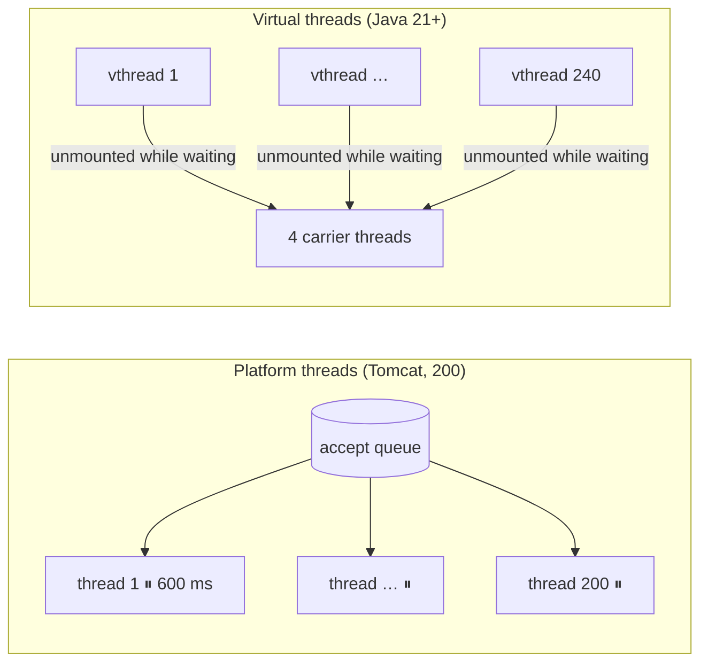
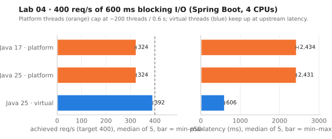
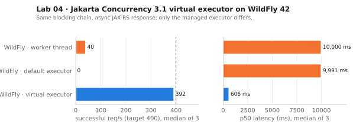
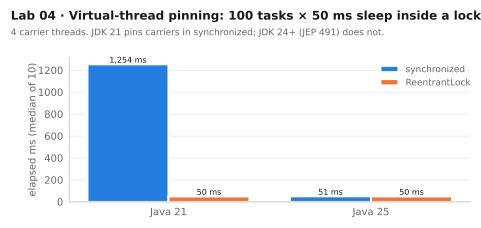

# Lab 04 — Platform threads, virtual threads and runtime versions

> **Use case:** the product-detail endpoint calls three slow services with blocking code. Traffic grows to 400 requests per second. Does a newer JVM help, do virtual threads help, and what happens on Jakarta EE and .NET?

## 1. Problem and why it matters

Thread-per-request with blocking I/O is the simplest programming model, but a platform thread is an OS thread: expensive, and limited by the server's pool. When requests mostly *wait*, the pool runs out long before the CPU does. Virtual threads (Java 21+) promise to keep the simple model without the limit, and runtime upgrades are often expected to "make it faster". This lab separates the two effects.

## 2. Concepts

| Concept | Meaning |
|---|---|
| Little's law | requests in flight L = throughput λ × time in system W. At 400 req/s × 0.6 s, **240 requests** are blocked at any moment |
| Platform thread | 1:1 with an OS thread; a blocking call parks it |
| Virtual thread | a JVM-scheduled thread; a blocking call *unmounts* it and frees the carrier (an OS thread of a small ForkJoinPool) |
| Pinning | a virtual thread that cannot unmount (JDK 21: blocking inside `synchronized`) keeps its carrier busy |
| ThreadPool starvation (.NET) | blocked pool threads wait for continuations that themselves need pool threads |

Theoretical ceilings for 600 ms of blocking per request: Tomcat 200 threads / 0.6 s ≈ **333 req/s**; WildFly Undertow workers (16 × 4 CPUs = 64) / 0.6 s ≈ **107 req/s**; virtual threads: no thread ceiling.

## 3. Incorrect and correct implementations

| Variant | Where | Character |
|---|---|---|
| blocking calls on platform request threads | Spring `LAB_VIRTUAL_THREADS=false`, WildFly worker threads (`/lab/io/blocking`) | correct, but capacity = pool / latency |
| blocking calls on virtual threads | Spring `LAB_VIRTUAL_THREADS=true` (Tomcat runs each request on a new virtual thread) | correct and scales for I/O |
| blocking chain on a container-managed executor | Jakarta `/lab/io/blocking-async?executor=default\|virtual` (Concurrency 3.1 `@ManagedExecutorDefinition(virtual=true)`) | async JAX-RS response; frees the Undertow worker |
| sync-over-async ✖ | .NET `/lab/io/blocking` (`GetAwaiter().GetResult()`) | anti-pattern: ThreadPool starvation |
| blocking inside `synchronized` on virtual threads | Spring `/lab/threads/pinning?mode=synchronized` | pins carriers on JDK 21, fine on JDK 24+ |

Code: [EngineeringController](../../implementations/spring-boot/app/src/main/java/de/backendlab/labs/EngineeringController.java), [Endpoints](../../implementations/jakarta-ee/src/main/java/de/backendlab/ee/Endpoints.java), [Api](../../implementations/jakarta-ee/src/main/java/de/backendlab/ee/Api.java) (executor definition), [Program.cs](../../implementations/aspnet-core/Lab.Api/Program.cs).

## 4. Framework and runtime differences

| | Spring Boot | Jakarta EE (WildFly 42) | ASP.NET Core |
|---|---|---|---|
| request threads | Tomcat pool (200) or virtual threads | Undertow worker pool (64 at 4 CPUs) | Kestrel + ThreadPool |
| virtual threads | `spring.threads.virtual.enabled` | managed executor with `virtual=true` (verified: tasks run on `VirtualThread[#…]/runnable@ForkJoinPool-1-worker-…`) | not applicable (async/await is the model) |
| runtime versions | same jar on Java 17 and Java 25 images | Java 25 | .NET 10 and .NET 11 images |

**Verification of actual execution** (`/lab/threads/info`, `/lab/threads/executor`): Spring platform `http-nio-…-exec-3, virtual=false`; Spring virtual `tomcat-handler-2, virtual=true`; Java 17 `runtime 17.0.21.1`; WildFly managed virtual executor `VirtualThread[#270]/runnable@ForkJoinPool-1-worker-1, virtual=true`, default executor `EE-ManagedExecutorService-default-Thread-1, virtual=false`; .NET `runtime 10.0.15` / `11.0.0`.

## 5. Correctness tests

Every request must return three ordered upstream bodies (k6 JSON check; `compare_http.py`). The pinning probe checks elapsed time against the theory: ⌈tasks / carriers⌉ × sleep when pinned, ≈ sleep otherwise.

## 6. Benchmark methodology

k6 constant arrival **400 req/s** on the blocking endpoint for 30 s, one 10 s warm-up, then **5 measured repetitions** (Jakarta/.NET saturation: 3), 4 CPUs / 2 GB, VUs up to 3,000, 10 s client timeout. The upstream mock is a single-threaded asyncio server, so it cannot become the bottleneck ([why](../../reports/investigations/2026-11-27-anomalies.md#1-virtual-threads-slower-than-platform-threads-at-400-reqs-lab-04)). The suite waits until the backend has drained its queue before the next run.

## 7. Results

<picture><source media="(prefers-color-scheme: dark)" srcset="../../docs/images/lab04-threads-dark.svg"></picture>

### 7.1 Spring Boot, 400 req/s blocking I/O, 5 runs — median [min – max]

| Configuration | achieved req/s | p50 ms | p99 ms | dropped | failed |
|---|---|---|---|---|---|
| Java 17 · platform | 324.2 [319.5 – 324.6] | 2,434 [2,411 – 2,479] | 4,019 [3,982 – 4,036] | 955 [943 – 1,135] | 0 % |
| Java 25 · platform | 324.2 [323.9 – 324.3] | 2,431 [2,419 – 2,436] | 4,015 [4,001 – 4,018] | 953 [951 – 964] | 0 % |
| **Java 25 · virtual** | **392.1 [391.8 – 392.1]** | **606 [606 – 607]** | **631 [616 – 714]** | **0** | 0 % |

At 50 req/s (below the ceiling) all three behave the same: p50 605.8 ms platform, 606.9 ms virtual.

Sources: [20261127T021849Z](../../reports/http-runs/20261127T021849Z/REPORT.md) (Java 25 platform and virtual), [20261127T063929Z](../../reports/http-runs/20261127T063929Z/REPORT.md) (Java 17). These replace the v2 repetition, which measured the old threaded mock upstream and **must not be quoted** ([investigation](../../reports/investigations/2026-11-27-anomalies.md)).

### 7.2 Jakarta EE and ASP.NET Core

**Jakarta EE / WildFly 42, 400 req/s, 3 runs** — [20261127T074359Z](../../reports/http-runs/20261127T074359Z/REPORT.md) (after fix F9):

<picture><source media="(prefers-color-scheme: dark)" srcset="../../docs/images/lab04-wildfly-virtual-dark.svg"></picture>

| Where the blocking chain runs | achieved req/s | **successful** req/s | p50 | failed |
|---|---|---:|---|---|
| Undertow worker thread (`/lab/io/blocking`) | 213.4 [210.3 – 213.8] | ≈ 40 | 10 s (client timeout) | 81.3 [81.3 – 88.6] % |
| default managed executor (`executor=default`) | 204.8 [204.7 – 204.9] | 0 | 10 s | 100 % |
| **virtual managed executor** (`executor=virtual`, `maxAsync=2000`) | **392.1 [392.0 – 392.1]** | **392** | **606 ms** | **0 %** |

**ASP.NET Core, 400 req/s, sync-over-async, per run in order** — [20261127T063929Z](../../reports/http-runs/20261127T063929Z/REPORT.md):

| Runtime | run 1 | run 2 | run 3 |
|---|---|---|---|
| .NET 10.0.15 | 100 % failed, CPU 1.9 % | 83.8 % failed | **0 % failed, 392 req/s, p50 605 ms** |
| .NET 11.0.0 | 100 % failed, CPU 3.2 % | 17.8 % failed | **0 % failed, 392 req/s, p50 604 ms** |

### 7.3 Pinning (100 virtual threads, each sleeps 50 ms inside its own lock; 4 carriers; median of 10)

<picture><source media="(prefers-color-scheme: dark)" srcset="../../docs/images/lab04-pinning-dark.svg"></picture>

| Runtime | `synchronized` | `ReentrantLock` | source |
|---|---:|---:|---|
| Java 21.0.13.1 | **1,254.5 ms** [1,254 – 1,256] | 50.0 ms [50 – 51] | [011057Z](../../reports/http-runs/20261127T011057Z/REPORT.md) `v2-pinning-j21` |
| Java 25.0.5.1 | 51.0 ms [50 – 51] | 50.0 ms [50 – 54] | `v2-pinning-j25` |

Theory: pinned = ⌈100 / 4⌉ × 50 ms = 1,250 ms; not pinned = 50 ms.

## 8. Interpretation and trade-offs

**Observations**
1. Spring with platform threads stops at **324 req/s**, very close to 200 threads / 0.6 s = 333, with p50 2.4 s and ~950 dropped iterations per run. No request failed; they were all late.
2. Virtual threads served the full load (**392 req/s** = all 12,000 requests; k6 divides by the 30 s window plus the ~0.6 s graceful stop) at the upstream latency (p50 606 ms) with 0 errors, in 5 of 5 runs. CPU was not the limit in either configuration.
3. Java 17 and Java 25 with platform threads are indistinguishable (324.2 vs 324.2 req/s; p50 2,434 vs 2,431 ms).
4. WildFly worker threads collapse far below their theoretical 107 req/s (≈ 40 successful req/s) because the server keeps processing requests whose client already timed out. With a container-managed **virtual** executor the same blocking code served 392 req/s, but only after `maxAsync` was set explicitly ([F9](../../reports/investigations/2026-11-27-anomalies.md#3-wildfly-managed-virtual-thread-executor-100--timeouts-at-400-reqs-lab-04)).
5. .NET sync-over-async starved on every cold start and recovered on a warmed-up pool. .NET 10 and .NET 11 behaved the same.
6. Pinning: JDK 21 serialized 100 virtual threads on 4 carriers inside `synchronized` (1,254 ms, theory 1,250 ms); JDK 25 did not (51 ms).

**Explanations**
- (1, 2) Little's law: 240 requests must be in flight. A 200-thread pool cannot hold them, so the rest wait in the accept queue. Virtual threads unmount while blocked in the socket read, so the number of in-flight requests is no longer bounded by OS threads.
- (3) The limit is the thread count, not JIT or GC. A runtime upgrade cannot remove it.
- (4) Overload without deadline propagation produces wasted work: requests that will time out still occupy threads. The default managed executor is a small platform pool and is even more limited.
- (6) JEP 491 (JDK 24) lets virtual threads unmount while holding a monitor.

**Conclusions**
- For blocking I/O at high concurrency, change the **thread model** (virtual threads on Java, async on .NET), not the runtime version.
- Virtual threads remove the thread ceiling, not other limits. Keep the downstream bounded (DB pool, Lab 08) and use timeouts end to end.
- Check that the container really runs your work on virtual threads **and** with the concurrency you expect (F9).

| Option | Good for | Watch out for |
|---|---|---|
| platform thread pool | predictable limit = backpressure | capacity = pool / latency; goodput collapse past the knee |
| virtual threads | blocking-style code with many concurrent waits | pinning on JDK 21; unbounded concurrency hits downstream limits; container-managed executors may still bound tasks |
| async/reactive | maximum concurrency, explicit composition | complexity; in .NET never block on tasks |

## 9. Limitations

- One machine, Docker CPU quotas; the 400 req/s rate was not varied (no full capacity curve).
- Tomcat's thread count was left at its default (200); raising it moves the platform ceiling.
- The JDK `HttpClient` uses its own internal executor even for blocking `send()` (hundreds of platform worker threads were observed under virtual-thread load); a different HTTP client may behave differently.
- The pinning experiment uses sleep inside `synchronized`; real pinning also comes from native calls and some library code.

## 10. Use cases and interview questions

- I/O-heavy APIs, gateways and aggregators written in blocking style; JDBC-heavy services (but see Lab 08: the pool still limits).
- *What problem do virtual threads solve?* The thread ceiling for blocking I/O (Little's law).
- *What don't they solve?* CPU-bound work (Lab 05), downstream limits (Lab 08), pinning on JDK 21.
- *Does upgrading Java 17 → 25 help this workload?* No; the limit is the pool, not the JIT.
- *What is the .NET equivalent?* async/await end to end; never block on tasks.
