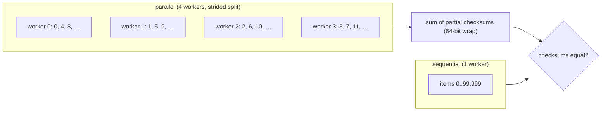
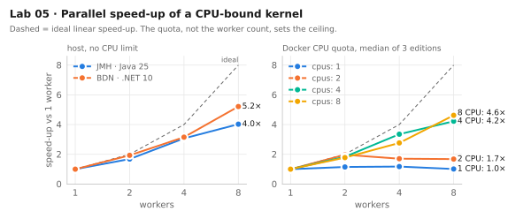

# Lab 05 — Multicore CPU processing

> **Use case:** every night each product's price is recalculated by a CPU-heavy formula. How much faster is it on 2, 4 or 8 cores, and what does a container CPU limit change?

## 1. Problem and why it matters

CPU-bound work only gets faster with more cores, and only up to the CPU the process is actually allowed to use. In containers that limit is a **quota**, not a number of physical cores. Too few workers waste hardware; too many add scheduling overhead and, under a quota, throttling.

## 2. Concepts

| Concept | Meaning here |
|---|---|
| Parallelism | the same job split into slices that run at the same instant on different cores |
| Amdahl's law | speed-up ≤ 1 / (serial part + parallel part / N) |
| CPU quota (`docker --cpus 4`) | 400 ms of CPU time per 100 ms period, on **any** of the host's cores (CFS bandwidth control) |
| Oversubscription | more runnable threads than usable CPU → context switches, throttling |
| CPU-bound vs I/O-bound | CPU-bound: more cores help, more threads do not; I/O-bound: more concurrency helps, cores barely matter (Labs 03/04) |

## 3. Implementations

The kernel: for each item `i`, start at `i+1` and apply `rounds` xorshift steps (`x ^= x<<13; x ^= x>>>7; x ^= x<<17`), then sum with signed 64-bit wrap-around. There is no I/O and no shared mutable state except the final sum, so there is no "incorrect" variant to show. The point of this lab is how much parallelism the hardware and quota really give.

| Edition | Code | Parallelism |
|---|---|---|
| Spring Boot | `Experiments.cpu` ([Experiments.java](../../implementations/spring-boot/cache-core/src/main/java/de/backendlab/experiments/Experiments.java)) | `workers` `CompletableFuture`s on a fixed 32-thread pool |
| Jakarta EE | same kernel | `ManagedExecutorService` |
| ASP.NET Core | `Lab.Cpu` ([Program.cs](../../implementations/aspnet-core/Lab.Api/Program.cs)) | `Parallel.For(…, MaxDegreeOfParallelism = workers)`, local sums + `Interlocked.Add` |

Endpoint: `GET /lab/cpu/{sequential|parallel}?count=100000&rounds=500&workers=N` → `{checksum, elapsedNs, processors}`. `elapsedNs` is measured inside the server, so HTTP is excluded. `processors` is what the runtime thinks it may use.

## 4. Framework and runtime differences

- The JVM and .NET both read the cgroup quota: `availableProcessors()` / `Environment.ProcessorCount` reported 1, 2, 4 and 8 under quotas of 1, 2, 4 and 8, so default pool sizes adapt automatically.
- Java uses an explicit pool; `Parallel.For` partitions the range itself and runs the body inline on the calling and pool threads.

## 5. Correctness tests

The checksum must be identical for sequential and every parallel configuration, in Java and .NET (`ExperimentTests.SameChecksum`, `compare_http.py`, `check_extended.py`, CPU probe). Measured: `-980176603291609351` in all 13 container configurations and both runtimes.

## 6. Benchmark methodology

| Benchmark | Setup |
|---|---|
| JMH `EngineeringBenchmark.cpu` | host JVM (20 logical CPUs, no quota), count 100,000, rounds 100, workers 1/2/4/8, 2 forks |
| BDN `CpuBench` | host .NET 10, same workload |
| CPU probe | each edition in Docker with `cpus` 1/2/4/8; rounds 500; 5 warm-up + 15 measured calls; median of server-side `elapsedNs` |

## 7. Results

<picture><source media="(prefers-color-scheme: dark)" srcset="../../docs/images/lab05-cpu-dark.svg"></picture>

**Host microbenchmarks** (rounds = 100) — [JMH](../../reports/runs/20261126T194918342533Z/REPORT.md), [BDN](../../reports/bdn-runs/net10/results/CpuBench-report-github.md):

| Workers | JMH Java 25 (ms) | speed-up | BDN .NET 10 (ms) | speed-up |
|---:|---:|---:|---:|---:|
| 1 | 22.41 ± 3.95 | 1.0× | 27.47 ± 1.12 | 1.0× |
| 2 | 13.33 ± 1.71 | 1.7× | 14.22 ± 0.62 | 1.9× |
| 4 | 7.30 ± 0.56 | 3.1× | 8.71 ± 0.27 | 3.2× |
| 8 | 5.57 ± 0.48 | 4.0× | 5.27 ± 0.14 | 5.2× |

**Containers** (rounds = 500, median ms of 15 calls) — run [20261126T222721Z](../../reports/http-runs/20261126T222721Z/REPORT.md):

| Quota | Edition | sequential | 2 workers | 4 workers | 8 workers |
|---:|---|---:|---:|---:|---:|
| 1 | Spring / Jakarta / .NET | 122.0 / 127.5 / 125.6 | 106.3 / 111.5 / 108.2 | 102.7 / 108.5 / 123.4 | 181.9 / 119.0 / 124.2 |
| 2 | Spring / Jakarta / .NET | 126.0 / 167.5 / 142.9 | **64.0 / 68.3 / 76.8** | 82.0 / 80.5 / 83.8 | 88.4 / 69.1 / 85.2 |
| 4 | Spring / Jakarta / .NET | 114.3 / 113.7 / 122.2 | 62.4 / 62.5 / 65.9 | 33.8 / 40.9 / 36.5 | **27.4 / 26.9 / 25.4** |
| 4 | .NET 11 | 132.6 | 69.6 | 43.3 | **30.8** |
| 8 | Spring / Jakarta / .NET | 132.3 / 131.2 / 159.1 | 74.4 / 65.5 / 108.7 | 48.8 / 47.5 / 50.9 | **28.6 / 36.4 / 26.6** |

The sequential baseline itself varies from 114 to 168 ms between phases. That ±20 % is the noise floor of this laptop (turbo, hybrid P/E cores), so read trends, not last digits.

## 8. Interpretation and trade-offs

**Observations**
1. 1-CPU quota: no configuration beats sequential by more than 1.2×; Spring with 8 workers is slower (182 ms).
2. 2-CPU quota: 2 workers is best (≈ 2×); 4 and 8 workers are slower than 2.
3. 4-CPU quota: 8 workers beat 4 workers (25–31 ms vs 34–43 ms).
4. No quota (host): 8 workers give 4.0× (Java) and 5.2× (.NET), not 8×.

**Explanations**
- (1, 2) More runnable threads than CPU time means context switches and CFS throttling without extra throughput.
- (3) A quota is *time*, not cores: a ~27 ms burst on 8 threads uses ~216 ms of CPU, which fits inside one 100 ms period's 400 ms budget. Under sustained load (many concurrent requests) the quota would throttle, and the 4-worker figure is the sustainable one. *This is an explanation consistent with CFS semantics; it was not verified with `cpu.stat` throttling counters for these specific runs.*
- (4) The i7-13700H has 6 performance and 8 efficiency cores plus hyper-threading. A static strided split gives equal work to fast and slow cores, so the slowest worker sets the end time, and turbo frequency drops as more cores are busy.

**Conclusions:** size CPU-bound pools by the CPU you can use **under sustained load**. Parallelism inside one request improves that request's latency but competes with other requests for the same cores. Virtual threads and async don't help CPU-bound work.

## 9. Limitations

- Docker quotas on a laptop are not pinned cores; one probe run per quota (15 samples each).
- The work split is static (strided). A work-stealing partitioner might scale better on hybrid CPUs; not measured.

## 10. Use cases and interview questions

- Batch recalculation, image/thumbnail processing, report generation, hashing.
- *Concurrency vs parallelism?* Parallelism needs cores (this lab); concurrency needs only overlap (Lab 03).
- *How many threads for CPU-bound work in a container?* About the quota under sustained load; check `availableProcessors()` / `ProcessorCount`.
- *Why not 8× with 8 threads?* Amdahl, hybrid cores, frequency scaling, scheduling and quota effects.
