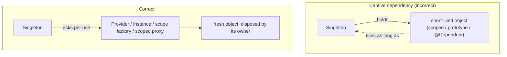
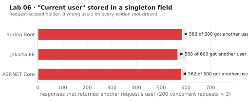
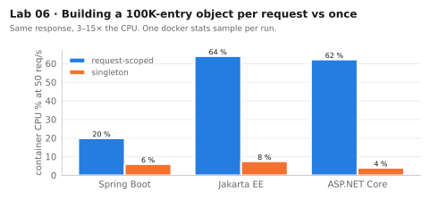

# Lab 06 — Dependency-injection lifetimes, ownership and shared state

> **Use case:** a service needs a large reference table, the "current user" of a request, and disposable resources inside background work. Which lifetime is right, who cleans up, and what breaks under concurrency?

## 1. Problem and why it matters

DI containers decide **how long an object lives** and **who disposes it**. The wrong choice rarely fails a unit test, but in production it shows up as wasted CPU, leaked connections, or one user seeing another user's data. The three frameworks look similar but have different rules, so a habit that is correct in one is a bug in another.

## 2. Concepts

| Concept | Spring IoC | CDI (Jakarta EE) | ASP.NET Core DI |
|---|---|---|---|
| one per application | singleton (default) | `@ApplicationScoped` | `AddSingleton` |
| one per HTTP request | `@RequestScope` | `@RequestScoped` | `AddScoped` (one scope per request) |
| new per lookup | `@Scope("prototype")` | `@Dependent` (default) | `AddTransient` |
| short-lived bean injected into a long-lived one | request scope: injected as a **proxy** (safe); prototype: captured once | normal scopes: client **proxy** (safe); `@Dependent`: owned by the holder | **the instance itself**: captured (`ValidateScopes` throws only in Development) |
| who destroys short-lived objects | request scope: container; **prototype: nobody – the caller** | the owner; `Instance.get()` needs `destroy()` | the scope that resolved it; the root scope lives until shutdown |
| background work | inject thread-safe singletons; request scope does not exist outside a request | `@ActivateRequestContext` or no request-scoped beans | `IServiceScopeFactory.CreateScope()` per unit of work |

## 3. Incorrect and correct implementations

All routes are under `/lab/di` ([DiController](../../implementations/spring-boot/app/src/main/java/de/backendlab/labs/DiController.java), [DiResource](../../implementations/jakarta-ee/src/main/java/de/backendlab/ee/DiResource.java), [Program.cs](../../implementations/aspnet-core/Lab.Api/Program.cs)).

| Scenario | Incorrect | Correct | Editions |
|---|---|---|---|
| expensive shared data (100K entries) | `instances?mode=request`: built per request | `mode=shared`: built once | all |
| captive dependency | `captive?mode=captured`: Spring prototype / CDI `@Dependent` / .NET **scoped** held by a singleton | Spring `ObjectProvider`, CDI `Instance<T>`, .NET resolve per request scope | all |
| shared mutable request state | `mutable?mode=singleton`: "current user" in a singleton field | `mode=request`: request-scoped holder | all |
| resource ownership | Spring: rely on the container to close prototypes (`ownership?mode=container`); CDI: `Instance.get()` without `destroy()` (`leak`); .NET: disposable transient resolved from the **root** provider, as a BackgroundService often does (`root`) | caller closes (`caller`); `Instance.destroy()` (`destroy`); one scope per unit of work (`scope`) | each in its own idiom |
| request context in background work | CDI: managed-executor task touches a `@RequestScoped` bean (`background?mode=plain`) | `@ActivateRequestContext` (`activated`) | Jakarta |

Not ported artificially: Spring has no "scoped resolved from root" problem, because request beans are proxies and DB access goes through thread-safe singletons (`JdbcTemplate`). .NET has no `@Dependent`; CDI has no transient-from-root.

## 4. Correctness tests

- `compare_http.py` (all editions): captured id is stable, fresh id changes, request-scoped `mutable` is correct.
- Suite probes `di2` (captive identity, 3 × 200 concurrent `mutable` requests per mode) and `ownership` (100 objects per mode).
- No throughput benchmark is needed for captive/ownership; counts and identities are the evidence.

## 5. Benchmark methodology

Only the payload-lifetime case has a load test: k6 at 50 req/s for 30 s per mode, 4 CPUs, one `docker stats` CPU sample per run. Every `request` call builds the full payload (Java: 100K `Product` records; .NET: `string[100000]`).

## 6. Results

<picture><source media="(prefers-color-scheme: dark)" srcset="../../docs/images/lab06-mutable-dark.svg"></picture>

**Shared mutable state and captive dependency** — run [20261127T011057Z](../../reports/http-runs/20261127T011057Z/REPORT.md), phases `v2-new-*`:

| Edition | singleton holder: wrong user | request-scoped: wrong user | captured: distinct ids in 5 calls | fresh: distinct ids |
|---|---:|---:|---:|---:|
| Spring Boot | 586 / 600 | 0 / 600 | 1 | 5 |
| Jakarta EE | 568 / 600 | 0 / 600 | 1 | 5 |
| ASP.NET Core | 582 / 600 | 0 / 600 | 1 | 5 |

A repeat in phase `v3-spring` gave 577 / 600 and 0 / 600.

**Ownership** (100 objects per mode, phases `v3-*`):

| Edition | incorrect: created / cleaned up | correct: created / cleaned up |
|---|---|---|
| Spring (prototype `@PreDestroy`) | `container`: 100 / **0** | `caller`: 100 / 100 |
| Jakarta (`@Dependent` via `Instance`) | `leak`: 100 / **0** | `destroy`: 100 / 100 |
| .NET (disposable transient) | `root`: 100 / **0** (held until shutdown) | `scope`: 100 / 100 |
| Jakarta background task + `@RequestScoped` | `plain`: **`ContextNotActiveException`** | `activated`: `ok: worker` |

**Payload lifetime** — run [20261126T222721Z](../../reports/http-runs/20261126T222721Z/REPORT.md), ms:

<picture><source media="(prefers-color-scheme: dark)" srcset="../../docs/images/lab06-di-cpu-dark.svg"></picture>

| Edition | request-scoped p50 / p95 / p99 | singleton p50 / p95 / p99 | CPU request / singleton |
|---|---|---|---|
| Spring Boot | 2.65 / 6.65 / 8.38 | 1.60 / 2.62 / 2.99 | 20 % / 6 % |
| Jakarta EE | 3.60 / 8.28 / 12.44 | 1.59 / 2.14 / 2.72 | 64 % / 8 % |
| ASP.NET Core | 5.77 / 42.98 / 61.98 | 0.79 / 1.48 / 2.16 | 62 % / 4 % |

## 7. Interpretation and trade-offs

**Observations**
1. A singleton holding per-request data returned the wrong user in 95–98 % of concurrent responses, on all three frameworks.
2. Captured short-lived objects kept one identity forever; the provider/scope variants created a new one per call.
3. Objects whose cleanup was left to the wrong party were never cleaned up (0 / 100) in all three idioms.
4. Building the payload per request cost 3–15× the CPU; on .NET p95 rose to 43 ms.

**Explanations**
- (1) Lifetime says nothing about thread safety. With a 5 ms gap between "set user" and "read user", every concurrent request overwrites the same field.
- (3) Spring documents that it does not manage the full lifecycle of prototypes; CDI keeps `@Dependent` objects created by `Instance` until the owner or `destroy()` releases them; .NET's root scope tracks disposable transients until the application stops. In a BackgroundService that loops, the last case is a steady memory/handle leak.
- (4) .NET's `string[100000]` (800 KB) lands on the Large Object Heap, which is only collected in gen-2 GCs. The Java payloads are many small objects that die young. This is an explanation from GC design; a GC log was not captured.

**Conclusions:** singletons must be stateless or immutable; get short-lived objects through a provider or scope; whoever creates an object owns its cleanup; background work needs its own scope or request context.

## 8. Limitations

- CPU is one `docker stats` sample per run; no allocation profiler or GC log was captured for the HTTP runs.
- The payloads differ between Java and .NET; compare the request-vs-singleton ratio within an edition.
- DbContext / EntityManager lifecycles are not exercised (no ORM in this lab). The .NET ownership case models the same rule with a disposable resource.

## 9. Use cases and interview questions

- Multi-tenant context, security principal, unit of work, `DbContext`, `HttpClient` handlers, caches.
- *Is a singleton thread-safe?* Only if it is stateless, immutable or synchronized; see observation 1.
- *Why can Spring inject a request bean into a singleton but .NET cannot inject scoped into singleton?* Spring and CDI inject proxies for normal scopes; .NET injects the instance.
- *How does a BackgroundService use a scoped `DbContext`?* `using var scope = scopeFactory.CreateScope();` per iteration.
- *Why is my prototype's `@PreDestroy` never called?* Spring does not track prototypes after handing them out.
