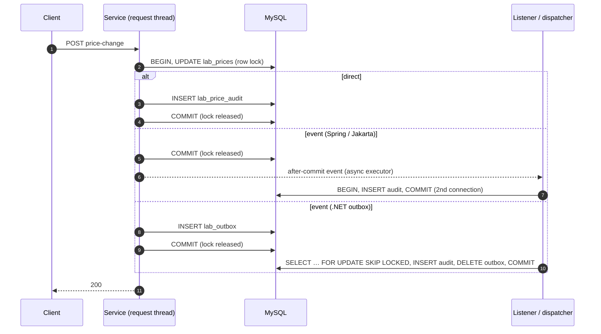
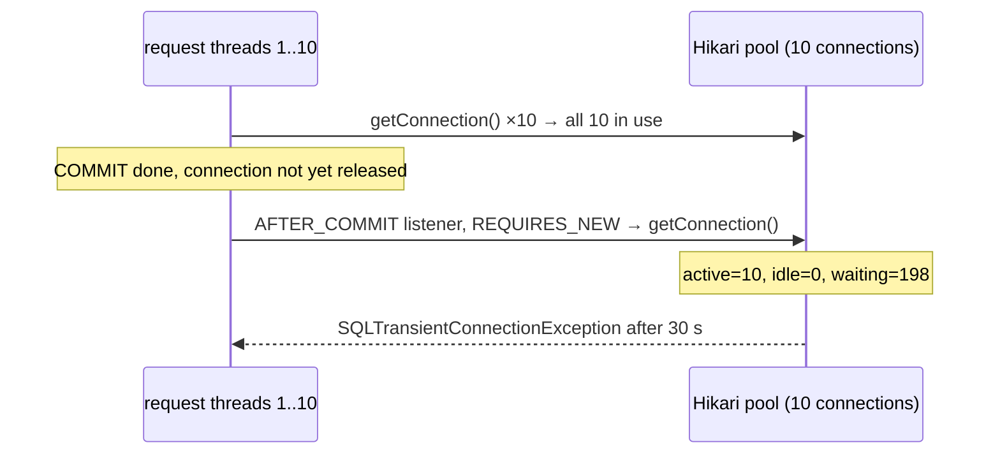
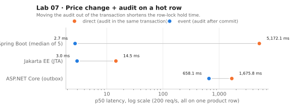

# Lab 07 — Direct orchestration versus domain events

> **Use case:** when a product price changes, an audit record must be written. Call the audit code directly in the transaction, or publish a `PriceChanged` event and handle it after commit?

## 1. Problem and why it matters

Side effects of a state change (audit, cache invalidation, notifications, integration messages) are where transactions, coupling and durability collide. A direct call keeps everything atomic but couples the caller to every side effect and lengthens the transaction. An after-commit event decouples them, but the side effect can be delayed or lost. Getting connection ownership wrong can freeze the whole service.

## 2. Concepts

| Concept | Meaning |
|---|---|
| Transaction boundary | everything inside commits or rolls back together |
| After-commit listener | runs only if the transaction committed (Spring `AFTER_COMMIT`, CDI `during = AFTER_SUCCESS`) |
| `REQUIRES_NEW` | suspend the current transaction and start an independent one, which needs **another connection** |
| Transactional outbox | write the event as a row in the same transaction; a dispatcher delivers it afterwards (at-least-once) |
| Hot row | many concurrent transactions updating the same row serialize on its row lock |

The connection-pool deadlock of the inline variant (conceptual, observed in the thread dump):

## 3. Incorrect and correct implementations

`POST /lab/events/price-change?id&cents&mode&rollback&failAudit`, state via `GET /lab/events/state?id`.

| Mode | Spring Boot ([EventController](../../implementations/spring-boot/app/src/main/java/de/backendlab/labs/EventController.java)) | Jakarta EE ([EventResource](../../implementations/jakarta-ee/src/main/java/de/backendlab/ee/EventResource.java)) | ASP.NET Core ([Program.cs](../../implementations/aspnet-core/Lab.Api/Program.cs)) |
|---|---|---|---|
| `direct` | `@Transactional`: price + audit | JTA `@Transactional`: price + audit | MySQL transaction: price + audit |
| `event` | `@TransactionalEventListener(AFTER_COMMIT)` + `@Async` on a bounded 2-thread executor, audit in `REQUIRES_NEW` | `@Observes(during = AFTER_SUCCESS)` → `DefaultManagedExecutorService` → `@Transactional(REQUIRES_NEW)` | **transactional outbox**: price + outbox row; `OutboxDispatcher` writes the audit and deletes the row in one transaction, retries failures |
| `event-inline` (**negative**) | AFTER_COMMIT + `REQUIRES_NEW` on the request thread | same pattern on JTA | – |

`rollback=true` throws after the update. `failAudit=true` makes the audit step throw.

## 4. Framework differences

- **Spring:** after-commit callbacks run while the request still holds its JDBC connection. A listener needing a new transaction needs a second connection.
- **Jakarta / WildFly (JTA):** the same inline pattern did **not** deadlock at 200 req/s (below). A plausible reason is JTA's connection handling (handles are associated with the transaction and released at completion, plus a pool of 20), but this was not verified in the WildFly code.
- **.NET:** no framework transaction events; the outbox is explicit code. It makes delivery durable but keeps the outbox write *inside* the business transaction.

## 5. Correctness tests

| Test | Spring | Jakarta | .NET |
|---|---|---|---|
| `compare_http.py`: direct + event = +2 audit rows, rollback → HTTP 500 and price unchanged | ✔ | ✔ | ✔ |
| probe `events`: 100 direct + 100 event concurrently, 20 rollbacks | 200 / 200 audits, 0 rollbacks visible | 100 / 200 in the suite, see 7.3; 200 / 200 in isolation | 200 / 200, 0 visible |
| probe `failure`: `failAudit` × 10 per mode | direct: 500, price not committed, 0 audits · event: 200, **price committed, 0 audits (lost)** | same as Spring | direct: 500, not committed · event: 200, committed, **10 / 10 audits after retry**, outbox empty |

## 6. Benchmark methodology

k6, 200 req/s, 30 s, every request updates **the same product id 7** (deliberately a hot row), 4 CPUs. Spring `direct`/`event` were repeated 5×; `event-inline` ran in its own phase (it freezes the app).

## 7. Results

<picture><source media="(prefers-color-scheme: dark)" srcset="../../docs/images/lab07-events-dark.svg"></picture>

### 7.1 Latency at 200 req/s on one row (ms)

| Edition / mode | achieved req/s | p50 | p99 | failed | source |
|---|---:|---:|---:|---:|---|
| Spring `direct`, 5 runs: median [min – max] | 129.8 [93.2 – 143.3] | 5,172 [1,564 – 8,658] | 8,963 [6,154 – 10,002] | 0 [0 – 24.8] % | [003011Z](../../reports/http-runs/20261127T003011Z/REPORT.md) |
| Spring `event`, 5 runs | 200.0 [200.0 – 200.0] | 2.73 [1.95 – 3.20] | 7.86 [4.91 – 11.53] | 0 % | same |
| Spring `event-inline` | 67.8 | 10,000 (timeouts) | 10,001 | **100 %** | [202650Z](../../reports/http-runs/20261126T202650Z/REPORT.md) |
| Jakarta `direct` (JTA) | 200.0 | 14.5 | 220.6 | 0 % | [011057Z](../../reports/http-runs/20261127T011057Z/REPORT.md) |
| Jakarta `event` | 200.0 | 2.96 | 8.67 | 0 % | same |
| Jakarta `event-inline` | 200.0 | 7.65 | 34.8 | 0 % | same |
| .NET `direct` | 178.1 | 1,676 | 2,176 | 0 % | same |
| .NET `event` (outbox) | 190.9 | 658 | 956 | 0 % | same |

### 7.2 Handler failure (`failAudit`, phases `v3-*`, run [011057Z](../../reports/http-runs/20261127T011057Z/REPORT.md))

| Edition | direct | event |
|---|---|---|
| Spring | HTTP 500, price rolled back, 0 audits | HTTP 200, price committed, **0 / 10 audits** |
| Jakarta | same | same |
| .NET outbox | HTTP 500, price rolled back, 0 audits | HTTP 200, price committed, **10 / 10 audits** after retries, 0 pending |

### 7.3 Shared-executor delay (Jakarta, [investigation](../../reports/investigations/2026-11-27-anomalies.md#2-jakarta-100-of-200-audits-missing-in-the-events-probe-lab-07))

100 after-commit audits arrived within 1 s without other load, but only after **~130 s** while the same default executor was flooded with blocking tasks. When the container stopped earlier (in the suite), queued audits were lost.

## 8. Interpretation and trade-offs

**Observations → explanations**
1. Spring `direct` collapses on the hot row (p50 1.6–8.7 s across 5 runs, huge spread); `event` stays at ~3 ms. *Explanation:* the row lock is held across two statements and the commit in `direct`; `event` commits after one statement. The system sits at the knee (~150–200 tx/s), so small differences swing the result.
2. .NET `event` with the outbox is still slow (p50 658 ms). *Explanation:* the outbox insert is part of the transaction, so the lock is held just as long as in `direct`. Durability is paid for with transaction length.
3. Jakarta `direct` handled 200 req/s (p50 14.5 ms) where Spring and .NET could not. *Not explained:* the same SQL runs on another MySQL container; possible factors are JTA connection handling, the separate DB volume and timing. Treat as an open observation.
4. `event-inline` deadlocks Spring's Hikari pool (100 % failures) but not WildFly. See §4.
5. After-commit events lose the side effect when the handler fails or the process stops; the outbox delivers it eventually.

**Conclusions**

| Approach | Consistency | Coupling | Failure mode |
|---|---|---|---|
| direct, same transaction | atomic | caller knows every side effect | longer locks → hot-row collapse |
| after-commit event (async) | state first, side effect later | decoupled | **lost** on handler failure or crash; delayed by shared executors |
| transactional outbox | event committed atomically; delivered at least once | decoupled | longer transaction; needs a dispatcher and idempotent handlers |

Rule from the deadlock: a thread holding a pooled resource must never wait for a second unit of the same pool.

## 9. Limitations

- Every request hits one row on purpose. With random ids the hot-row effect would mostly disappear.
- Only Spring has repetitions; Jakarta and .NET load rows are single runs.
- The outbox dispatcher is in-process. With several instances, `SKIP LOCKED` lets them share work, but this was not tested with more than one instance.
- Cache invalidation timing for the catalogue (journal refresh) is covered in [Lab 01](../01-product-cache/README.md).

## 10. Use cases and interview questions

- Audit trails, search-index updates, e-mails, integration events to other services.
- *Why can `AFTER_COMMIT` + `REQUIRES_NEW` freeze a Spring service?* The pool deadlock above.
- *Domain events or outbox?* In-process events are not durable; an outbox is, at the cost of a longer transaction and a dispatcher.
- *What happens to after-commit work if the process crashes?* It is gone; see 7.2/7.3.
- *Is the event faster than the direct call?* Only because it moves work out of the critical section, and the outbox does not.
