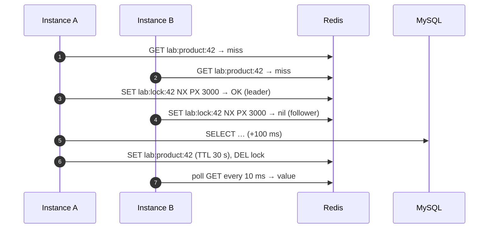
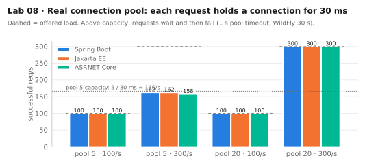
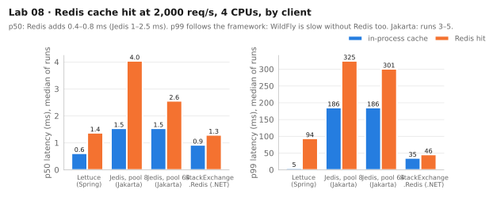

# Lab 08 — Cache stampede, shared caches and connection pools

> **Use cases**
> 1. A popular product's cache entry expires and 100 requests arrive at once. How many hit the database, on one instance and on two?
> 2. The database pool has 5 connections and each query holds one for 30 ms. What happens at 100 and at 300 requests per second?
> 3. Redis is shared by two instances. Does the Redis client library (Lettuce, Jedis, StackExchange.Redis) change the hit latency, or what users see while Redis is down and after it comes back?

## 1. Problem and why it matters

Scarce resources (database connections, an expensive query, a rate-limited API) fail in non-obvious ways. A cold cache key multiplies load exactly when the system is busiest, and a full pool turns into queueing, timeouts or errors depending on the framework. A shared cache such as Redis adds a network hop, a consistency question and a new failure mode.

## 2. Concepts

| Concept | Meaning |
|---|---|
| Cache stampede (thundering herd) | many concurrent misses for the same key all load it |
| Single-flight | the first caller loads; concurrent callers wait for its result |
| Distributed lock | single-flight across instances (here Redis `SET key value NX PX`) |
| Cache-aside | read cache → on a miss, load from the DB and write the cache |
| Little's law | concurrency = throughput × time held; pool capacity = size / hold time |
| Fail-open | when the cache is down, serve from the DB (availability over load protection) |

## 3. Implementations

| Experiment | Code | Incorrect → correct |
|---|---|---|
| in-process stampede | `Experiments.stampede` ([Java](../../implementations/spring-boot/cache-core/src/main/java/de/backendlab/experiments/Experiments.java)), `Lab.Stampede` ([.NET](../../implementations/aspnet-core/Lab.Api/Program.cs)) | `single=false` → `single=true` (double-checked load under a lock / `SemaphoreSlim`) |
| semaphore "pool" | `Experiments.pool`, `Lab.Pool` | models 5 permits, 30 ms work, 100 ms wait budget |
| **real connection pool** | [DbPoolController](../../implementations/spring-boot/app/src/main/java/de/backendlab/labs/DbPoolController.java) (Hikari), [Endpoints](../../implementations/jakarta-ee/src/main/java/de/backendlab/ee/Endpoints.java) `db()` (WildFly `@DataSourceDefinition`), `/lab/resources/db` (MySqlConnector) | pool 5 vs 20; each request holds a connection for `SELECT SLEEP(0.03)` |
| **Redis shared cache, 2 instances** | Spring: [RedisCacheController](../../implementations/spring-boot/app/src/main/java/de/backendlab/labs/RedisCacheController.java) (Lettuce) · Jakarta: [RedisResource](../../implementations/jakarta-ee/src/main/java/de/backendlab/ee/RedisResource.java) (Jedis 8) · .NET: `RedisLab` in [Program.cs](../../implementations/aspnet-core/Lab.Api/Program.cs) (StackExchange.Redis 3) · [docker-compose.redis.yml](../../docker-compose.redis.yml) | `mode=none` → `local` (per-instance single-flight) → `distributed` (Redis lock) |
| Redis TTL demo | [tools/redis_lab.py](../../tools/redis_lab.py) | standalone two-client TTL check, **not** a cache implementation |

Pool acquisition timeouts: Hikari 1 s, MySqlConnector 1 s, WildFly default (30 s, not configurable through `@DataSourceDefinition` attributes).

## 4. Framework differences

| | Spring Boot | Jakarta EE (WildFly) | ASP.NET Core |
|---|---|---|---|
| request threads while waiting for a connection | Tomcat thread blocked | Undertow worker blocked | none (async open) |
| pool timeout | 1 s → HTTP 503 | 30 s (default) → queueing | 1 s → HTTP 503 |
| concurrency available for a stampede | 32-thread executor | default managed executor: no explicit size in `standalone.xml`; measured 8 concurrent tasks at 4 CPUs and 40 at 20 CPUs (≈ 2 × CPUs) | unbounded async tasks |
| Redis client | Lettuce (Spring Data Redis): one shared connection, commands multiplexed; queues commands while reconnecting | Jedis 8 `RedisClient`: one pooled connection per command (`REDIS_POOL_MAX`, default 8; 500 ms wait for a free connection) | StackExchange.Redis: one multiplexed connection, async API, background reconnect |
| Redis timeouts (all set to 500 ms here) | command timeout (default 60 s) | connect + socket timeout (default 2 s) | connect, sync and async timeout (default 5 s) |

## 5. Correctness tests

- Invariants: `single=true` ⇒ exactly 1 load; semaphore `peak ≤ permits`; Redis `distributed` ⇒ 1 load across both instances.
- `compare_http.py`: single-flight, pool bound, real DB pool endpoint (all editions).
- Probes: `correctness` (stampede/pool, 10 / 5 repetitions), `redis` (5 rounds × 100 requests split over 2 instances per mode), `redis2` (stale read, invalidation, and an outage: 10 sequential + 50 concurrent requests while Redis is stopped and while it is paused, then time until Redis is used again).
- The same `redis` / `redis2` probes run on all three editions (phases `v5-redis-*`).

## 6. Benchmark methodology

- Real pool: k6 constant arrival 100 and 300 req/s, 30 s, pool 5 and 20, 4 CPUs. Capacity: 5 / 30 ms ≈ 166 req/s, 20 / 30 ms ≈ 666 req/s.
- Redis hit latency: k6 2,000 req/s on `/lab/redis/product/42` vs the in-process cache `/api/products/42`, 3 repetitions per client (Jakarta: 5, of which runs 1–2 are WildFly warm-up and excluded; the in-process WildFly baseline also needs a warm-up run).
- Outage: `docker stop` (container gone, the name `redis` no longer resolves) and `docker pause` (TCP connections stay open, Redis does not answer). All three clients use 500 ms timeouts, so differences come from client behaviour, not configuration.

## 7. Results

<picture><source media="(prefers-color-scheme: dark)" srcset="../../docs/images/lab08-stampede-dark.svg"></picture>

### 7.1 Stampede

| Setup | no coordination | single-flight | source |
|---|---|---|---|
| in-process, N = 100, Spring / Jakarta / .NET | 32 / 8 / 100 loads | 1 / 1 / 1 | [222721Z](../../reports/http-runs/20261126T222721Z/REPORT.md) |
| Redis, 2 instances × 50 requests, 5 rounds | `none`: 50, 89, 97, 100, 100 loads | `local`: 2 every round · `distributed`: 1 every round | [011057Z](../../reports/http-runs/20261127T011057Z/REPORT.md) `v2-redis-spring` |

### 7.2 Real connection pool (successful req/s = achieved × (1 − failed))

<picture><source media="(prefers-color-scheme: dark)" srcset="../../docs/images/lab08-dbpool-dark.svg"></picture>

| Edition | pool 5 @ 100/s | pool 5 @ 300/s | pool 20 @ 300/s |
|---|---|---|---|
| Spring (Hikari, 1 s timeout) | 99.9 req/s, p50 31.9 ms | 212.1 achieved, **23.4 % 503**, p50 3,484 ms | 299.7, p50 31.1 ms |
| Jakarta (WildFly, 30 s) | 99.9, p50 32.7 ms | 162.3 achieved, 0 % failed, **p50 6,054 ms**, 2,635 dropped | 299.7, p50 31.7 ms |
| .NET (MySqlConnector, 1 s) | 99.9, p50 31.9 ms | 283.3 achieved, **44.4 % 503**, p50 1,020 ms | 299.7, p50 31.6 ms |

Source: [011057Z](../../reports/http-runs/20261127T011057Z/REPORT.md), phases `v2-new-*`.

### 7.3 Redis behaviour (phase `v3-redis-spring`)

| Check | Result |
|---|---|
| A caches, DB renamed, B reads before invalidation | **stale** old name served by B (TTL 30 s) |
| after `POST /lab/redis/invalidate` | B loads the new name |
| Redis stopped | `source: db-fallback` after 511 ms (500 ms command timeout), catalogue API unaffected |
| Redis started again | caching resumes |
| hit latency at 2,000 req/s ([011057Z](../../reports/http-runs/20261127T011057Z/REPORT.md)) | Redis p50 1.00 / p99 43.96 ms, app CPU 119 % · in-process cache p50 0.54 / p99 5.59 ms, 77 % |

The consistency results were the same on all three editions in the v5 runs (stale read before invalidation, fresh after).

### 7.4 Redis clients compared

<picture><source media="(prefers-color-scheme: dark)" srcset="../../docs/images/lab08-redis-hit-dark.svg"></picture>

**Cache hit, 2,000 req/s, 4 CPUs** — median [min – max] of the runs; in-process baseline from the v2 repetitions (WildFly: runs 2–5).

| Client (edition) | runs | Redis p50 ms | Redis p99 ms | dropped (median) | in-process p50 / p99 ms | app CPU |
|---|---:|---|---|---:|---|---|
| Lettuce (Spring) | 3 | 1.37 [1.23 – 1.78] | 94.0 [30.8 – 152.6] | 394 | 0.62 / 5.2 | 212–251 % |
| Jedis, pool 8 (Jakarta) | 3 (runs 3–5) | 4.04 [1.96 – 38.89] | 324.8 [184.7 – 366.6] | 831 | 1.54 / 185.6 | 267–412 % |
| Jedis, pool 64 (Jakarta) | 3 (runs 3–5) | 2.56 [1.93 – 7.46] | 301.1 [195.6 – 308.9] | 761 | 1.54 / 185.6 | 221–403 % |
| StackExchange.Redis (.NET 10) | 3 | 1.30 [1.29 – 1.31] | 45.9 [41.0 – 50.8] | 20 | 0.93 / 35.5 | 174–227 % |

Fallbacks to MySQL during the k6 runs of the `v5-redis-*` phases (warm-up included): Lettuce 133, Jedis pool 8 263, Jedis pool 64 0, StackExchange.Redis 0. Lettuce's fallbacks happened outside the measured runs (measured max 437 ms, while a fallback takes > 500 ms).

<picture><source media="(prefers-color-scheme: dark)" srcset="../../docs/images/lab08-redis-outage-dark.svg"></picture>

**Outage** — every request still succeeded from MySQL (`source: db-fallback`) and the catalogue API was unaffected on all editions. Latency: median of 10 sequential requests [first request]; recovery: time from `docker start` / `docker unpause` until a request is served from Redis again.

| Client | stopped: latency | exception | recovery | paused: latency | exception | recovery |
|---|---|---|---:|---|---|---:|
| Lettuce | 507 ms [506] | `QueryTimeoutException` | 961 ms | 509 ms [531] | `QueryTimeoutException` | 6 ms |
| Jedis | **4 ms** [2,768] | `JedisConnectionException` | **9,532 ms** | 508 ms [1,013] | `JedisConnectionException` | 23 ms |
| Jedis, `sun.net.inetaddr.negative.ttl=0` | 513 ms [512] | `JedisConnectionException` | **10 ms** | 511 ms [1,032] | `JedisConnectionException` | 10 ms |
| StackExchange.Redis | **1,000 ms** [612] | `RedisConnectionException` | 726 ms | **999 ms** [729] | `RedisTimeoutException` | 945 ms |

50 concurrent requests during the outage, p50: 538 / 35 / 576 / 984 ms (stopped) and 527 / 526 / 532 / 1,000 ms (paused), in table order.

Sources: [172412Z](../../reports/http-runs/20261127T172412Z/REPORT.md) (`v5-redis-*`), [174040Z](../../reports/http-runs/20261127T174040Z/REPORT.md) (`v5b-redis-*`).

## 8. Interpretation and trade-offs

**Observations → explanations**
1. Single-flight reduced loads to 1 in every edition; without it the stampede size matched the **effective concurrency** (Spring pool 32, WildFly default executor 8 at 4 CPUs — 40 in the clean-checkout run without a CPU limit, .NET async 100), not the request count.
2. Across instances, local single-flight still loads once **per instance**; only the shared lock gives 1.
3. All three pools delivered ≈ 160 successful req/s at pool 5, as Little's law predicts (166). They differ in *how* they fail: .NET fails fast (async waiters, 1 s timeout), WildFly queues for up to 30 s (no errors, multi-second latency), Spring fails after 1 s but also queues in Tomcat.
4. Redis costs a network hop and CPU (p50 1.0 vs 0.54 ms) and returns stale data until invalidated.
5. **Hit latency hardly depends on the client.** Lettuce and StackExchange.Redis add 0.4–0.8 ms at p50; Jedis adds 1–2.5 ms. The tail follows the framework: WildFly's p99 is 186 ms already without Redis. A Jedis pool of 8 instead of 64 made no measurable steady-state difference (overlapping ranges), but under the overload of the first runs pool 8 sent 263 requests to MySQL because no connection was free within 500 ms; pool 64 sent none.
6. **The clients differ when Redis fails** (confirmed causes unless marked):
   - *Lettuce* keeps one connection and queues commands while it reconnects, so every request waits for the full 500 ms timeout in both outage types. It recovered within 1 s of the restart.
   - *Jedis* opens a new connection for each attempt. When the container is stopped, the name `redis` no longer resolves; the JVM caches that failed lookup for 10 s (`networkaddress.cache.negative.ttl`). That made failures fast (4 ms after the first) but recovery slow (9.5 s). With the negative cache disabled, recovery took 10 ms and each failure took ~510 ms instead, confirmed by the `v5b-redis-jakarta-dns0` A/B run. Why the first failing request took 2.8 s is not explained.
   - *StackExchange.Redis* needed ~1,000 ms per request with a 500 ms timeout in both outage types, and 0.7–0.9 s to recover. **Hypothesis, not verified:** the client checks timeouts and reconnects on a 1-second heartbeat, so the effective timeout is rounded up to the next tick.

**Conclusions**
- Protect expensive loads with single-flight; in a cluster, decide whether one load per instance is acceptable or a shared lock is needed.
- Size pools from hold time × target throughput, and choose a timeout that fails fast enough to protect the threads.
- A shared cache needs an invalidation story and a fail-open/closed decision. Fail-open keeps availability but removes stampede protection exactly when Redis is down.
- Measure the client's failure behaviour, not only its hit latency: the configured timeout is not the latency users see during an outage (StackExchange.Redis: 2×), and DNS caching can trade fast failure for slow recovery (Jedis on the JVM).
- With a pooled client, size the pool for the peak concurrency of Redis calls, or fallbacks start before Redis is actually slow.

## 9. Limitations

- The Redis lock is a lab simplification (GET+DEL release, fixed 3 s lease, no fencing token). It is not a correct distributed lock under GC pauses or network partitions.
- Two instances share one MySQL journal; the catalogue normally assumes a single refresh consumer.
- No Redis cluster, replication or eviction-policy experiments.
- One client per edition, default settings except the 500 ms timeouts (and the Jedis pool size); Redisson, Lettuce on Jakarta or other StackExchange.Redis heartbeat settings were not tried. For hit latency the client is therefore confounded with the framework (compare the in-process baselines).
- The outage probe ran once per client (10 + 50 requests per outage type), not repeated.
- The WildFly pool timeout was left at its default because `@DataSourceDefinition` has no standard attribute for it.

## 10. Use cases and interview questions

- Product detail caches, configuration lookups, token caches, expensive aggregations; DB pool sizing.
- *How do you stop a cache stampede?* Single-flight, plus early refresh or stale-while-revalidate; across instances a shared lock or a coalescing proxy.
- *What happens when the pool is exhausted?* It depends on the timeout and the thread model (§7.2).
- *What does Redis give and cost?* Shared state across instances; a hop, staleness, a new dependency and failure mode.
- *Your Redis timeout is 500 ms. How long do requests take while Redis is down?* It depends on the client: 500 ms (Lettuce), 4 ms or 500 ms depending on DNS caching (Jedis), ~1 s (StackExchange.Redis); see §7.4.
- *Multiplexed or pooled client?* A multiplexed client (Lettuce, StackExchange.Redis) needs no pool sizing; a pooled one (Jedis) must be sized for peak concurrency or requests wait for a connection.
