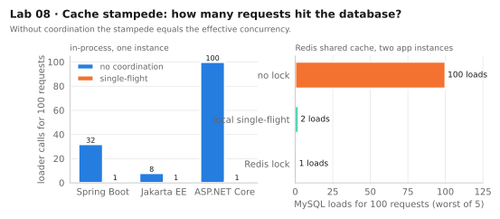

# Lab 08 — Cache stampede, shared caches and connection pools

> **Use cases**
> 1. A popular product's cache entry expires and 100 requests arrive at once. How many hit the database, on one instance and on two?
> 2. The database pool has 5 connections and each query holds one for 30 ms. What happens at 100 and at 300 requests per second?

## 1. Problem and why it matters

Scarce resources (database connections, an expensive query, a rate-limited API) fail in non-obvious ways. A cold cache key multiplies load exactly when the system is busiest, and a full pool turns into queueing, timeouts or errors depending on the framework. A shared cache such as Redis adds a network hop, a consistency question and a new failure mode.

## 2. Concepts

| Concept | Meaning |
|---|---|
| Cache stampede (thundering herd) | many concurrent misses for the same key all load it |
| Single-flight | the first caller loads; concurrent callers wait for its result |
| Distributed lock | single-flight across instances (here Redis `SET key value NX PX`) |
| Cache-aside | read cache → on a miss, load from the DB and write the cache |
| Little's law | concurrency = throughput × time held; pool capacity = size / hold time |
| Fail-open | when the cache is down, serve from the DB (availability over load protection) |

```mermaid
sequenceDiagram
  autonumber
  participant A as Instance A
  participant B as Instance B
  participant R as Redis
  participant DB as MySQL
  A->>R: GET lab:product:42 → miss
  B->>R: GET lab:product:42 → miss
  A->>R: SET lab:lock:42 NX PX 3000 → OK (leader)
  B->>R: SET lab:lock:42 NX PX 3000 → nil (follower)
  A->>DB: SELECT … (+100 ms)
  A->>R: SET lab:product:42 (TTL 30 s); DEL lock
  B->>R: poll GET every 10 ms → value
```

## 3. Implementations

| Experiment | Code | Incorrect → correct |
|---|---|---|
| in-process stampede | `Experiments.stampede` ([Java](../../implementations/spring-boot/cache-core/src/main/java/de/backendlab/experiments/Experiments.java)), `Lab.Stampede` ([.NET](../../implementations/aspnet-core/Lab.Api/Program.cs)) | `single=false` → `single=true` (double-checked load under a lock / `SemaphoreSlim`) |
| semaphore "pool" | `Experiments.pool`, `Lab.Pool` | models 5 permits, 30 ms work, 100 ms wait budget |
| **real connection pool** | [DbPoolController](../../implementations/spring-boot/app/src/main/java/de/backendlab/labs/DbPoolController.java) (Hikari), [DbPoolResource](../../implementations/jakarta-ee/src/main/java/de/backendlab/ee/DbPoolResource.java) (WildFly `@DataSourceDefinition`), `/lab/resources/db` (MySqlConnector) | pool 5 vs 20; each request holds a connection for `SELECT SLEEP(0.03)` |
| **Redis shared cache, 2 instances** | [RedisCacheController](../../implementations/spring-boot/app/src/main/java/de/backendlab/labs/RedisCacheController.java), [docker-compose.redis.yml](../../docker-compose.redis.yml) | `mode=none` → `local` (per-instance single-flight) → `distributed` (Redis lock) |
| Redis TTL demo | [tools/redis_lab.py](../../tools/redis_lab.py) | standalone two-client TTL check, **not** a cache implementation |

Pool acquisition timeouts: Hikari 1 s, MySqlConnector 1 s, WildFly default (30 s, not configurable through `@DataSourceDefinition` attributes).

## 4. Framework differences

| | Spring Boot | Jakarta EE (WildFly) | ASP.NET Core |
|---|---|---|---|
| request threads while waiting for a connection | Tomcat thread blocked | Undertow worker blocked | none (async open) |
| pool timeout | 1 s → HTTP 503 | 30 s (default) → queueing | 1 s → HTTP 503 |
| concurrency available for a stampede | 32-thread executor | managed executor (8 concurrent tasks observed) | unbounded async tasks |
| Redis shared cache | implemented | – | – |

## 5. Correctness tests

- Invariants: `single=true` ⇒ exactly 1 load; semaphore `peak ≤ permits`; Redis `distributed` ⇒ 1 load across both instances.
- `compare_http.py`: single-flight, pool bound, real DB pool endpoint (all editions).
- Probes: `correctness` (stampede/pool, 10 / 5 repetitions), `redis` (5 rounds × 100 requests split over 2 instances per mode), `redis2` (stale read, invalidation, Redis down / back).

## 6. Benchmark methodology

- Real pool: k6 constant arrival 100 and 300 req/s, 30 s, pool 5 and 20, 4 CPUs. Capacity: 5 / 30 ms ≈ 166 req/s, 20 / 30 ms ≈ 666 req/s.
- Redis hit latency: k6 2,000 req/s on `/lab/redis/product/42` vs the in-process cache `/api/products/42`.

## 7. Results

<picture><source media="(prefers-color-scheme: dark)" srcset="../../docs/images/lab08-stampede-dark.svg"></picture>

### 7.1 Stampede

| Setup | no coordination | single-flight | source |
|---|---|---|---|
| in-process, N = 100, Spring / Jakarta / .NET | 32 / 8 / 100 loads | 1 / 1 / 1 | [222721Z](../../reports/http-runs/20261126T222721Z/REPORT.md) |
| Redis, 2 instances × 50 requests, 5 rounds | `none`: 50, 89, 97, 100, 100 loads | `local`: 2 every round · `distributed`: 1 every round | [011057Z](../../reports/http-runs/20261127T011057Z/REPORT.md) `v2-redis-spring` |

### 7.2 Real connection pool (successful req/s = achieved × (1 − failed))

<picture><source media="(prefers-color-scheme: dark)" srcset="../../docs/images/lab08-dbpool-dark.svg"></picture>

| Edition | pool 5 @ 100/s | pool 5 @ 300/s | pool 20 @ 300/s |
|---|---|---|---|
| Spring (Hikari, 1 s timeout) | 99.9 req/s, p50 31.9 ms | 212.1 achieved, **23.4 % 503**, p50 3,484 ms | 299.7, p50 31.1 ms |
| Jakarta (WildFly, 30 s) | 99.9, p50 32.7 ms | 162.3 achieved, 0 % failed, **p50 6,054 ms**, 2,635 dropped | 299.7, p50 31.7 ms |
| .NET (MySqlConnector, 1 s) | 99.9, p50 31.9 ms | 283.3 achieved, **44.4 % 503**, p50 1,020 ms | 299.7, p50 31.6 ms |

Source: [011057Z](../../reports/http-runs/20261127T011057Z/REPORT.md), phases `v2-new-*`.

### 7.3 Redis behaviour (phase `v3-redis-spring`)

| Check | Result |
|---|---|
| A caches, DB renamed, B reads before invalidation | **stale** old name served by B (TTL 30 s) |
| after `POST /lab/redis/invalidate` | B loads the new name |
| Redis stopped | `source: db-fallback` after 511 ms (500 ms command timeout), catalogue API unaffected |
| Redis started again | caching resumes |
| hit latency at 2,000 req/s ([011057Z](../../reports/http-runs/20261127T011057Z/REPORT.md)) | Redis p50 1.00 / p99 43.96 ms, app CPU 119 % · in-process cache p50 0.54 / p99 5.59 ms, 77 % |

## 8. Interpretation and trade-offs

**Observations → explanations**
1. Single-flight reduced loads to 1 in every edition; without it the stampede size matched the **effective concurrency** (Spring pool 32, WildFly executor 8, .NET async 100), not the request count.
2. Across instances, local single-flight still loads once **per instance**; only the shared lock gives 1.
3. All three pools delivered ≈ 160 successful req/s at pool 5, as Little's law predicts (166). They differ in *how* they fail: .NET fails fast (async waiters, 1 s timeout), WildFly queues for up to 30 s (no errors, multi-second latency), Spring fails after 1 s but also queues in Tomcat.
4. Redis costs a network hop and CPU (p50 1.0 vs 0.54 ms) and returns stale data until invalidated.

**Conclusions**
- Protect expensive loads with single-flight; in a cluster, decide whether one load per instance is acceptable or a shared lock is needed.
- Size pools from hold time × target throughput, and choose a timeout that fails fast enough to protect the threads.
- A shared cache needs an invalidation story and a fail-open/closed decision. Fail-open keeps availability but removes stampede protection exactly when Redis is down.

## 9. Limitations

- The Redis lock is a lab simplification (GET+DEL release, fixed 3 s lease, no fencing token). It is not a correct distributed lock under GC pauses or network partitions.
- Two instances share one MySQL journal; the catalogue normally assumes a single refresh consumer.
- No Redis cluster, replication or eviction-policy experiments; Redis was only measured with Spring.
- The WildFly pool timeout was left at its default because `@DataSourceDefinition` has no standard attribute for it.

## 10. Use cases and interview questions

- Product detail caches, configuration lookups, token caches, expensive aggregations; DB pool sizing.
- *How do you stop a cache stampede?* Single-flight, plus early refresh or stale-while-revalidate; across instances a shared lock or a coalescing proxy.
- *What happens when the pool is exhausted?* It depends on the timeout and the thread model (§7.2).
- *What does Redis give and cost?* Shared state across instances; a hop, staleness, a new dependency and failure mode.
