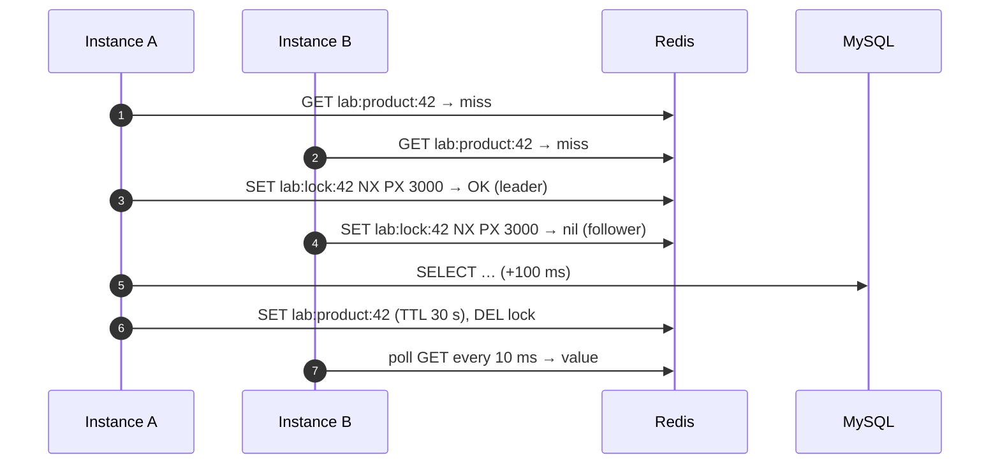
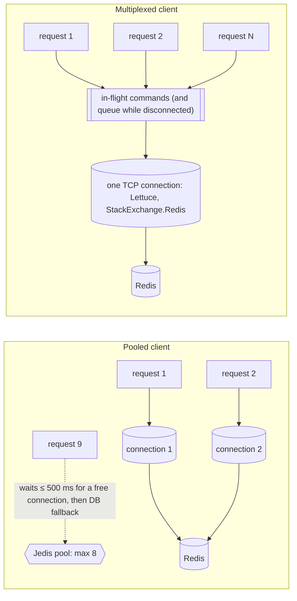
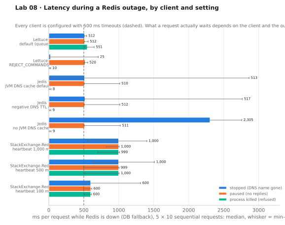
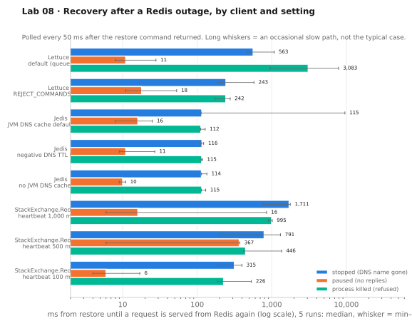
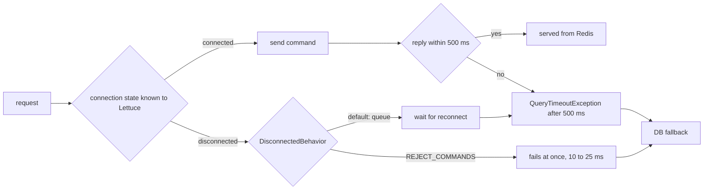
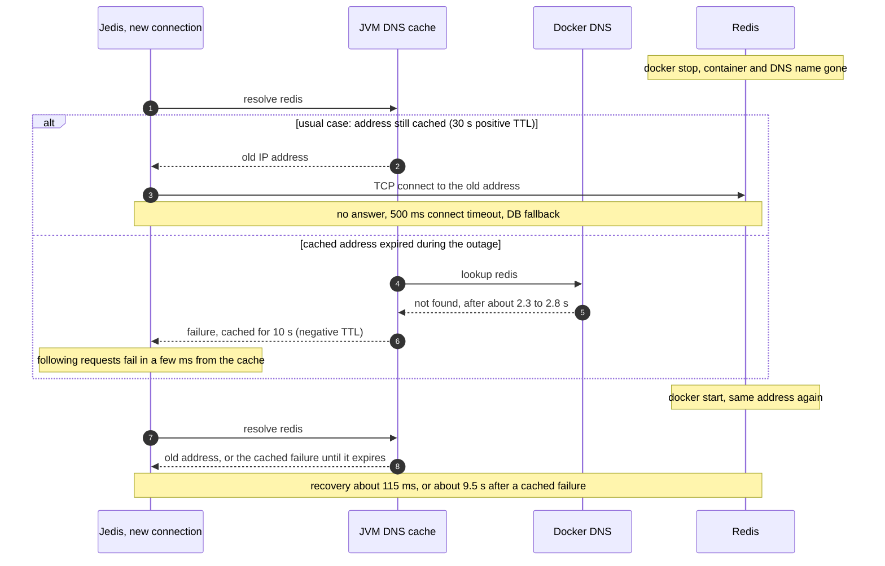
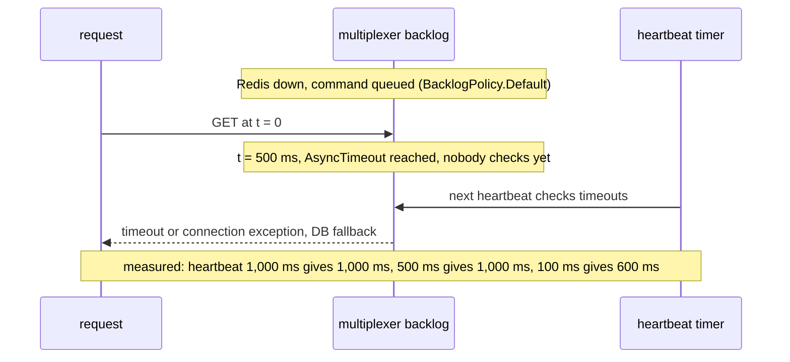

# Lab 08 — Cache stampede, shared caches and connection pools

> **Use cases**
> 1. A popular product's cache entry expires and 100 requests arrive at once. How many hit the database, on one instance and on two?
> 2. The database pool has 5 connections and each query holds one for 30 ms. What happens at 100 and at 300 requests per second?
> 3. Redis is shared by two instances. Does the Redis client library (Lettuce, Jedis, StackExchange.Redis) change the hit latency, or what users see while Redis is down and after it comes back?

## 1. Problem and why it matters

Scarce resources (database connections, an expensive query, a rate-limited API) fail in non-obvious ways. A cold cache key multiplies load exactly when the system is busiest, and a full pool turns into queueing, timeouts or errors depending on the framework. A shared cache such as Redis adds a network hop, a consistency question and a new failure mode.

## 2. Concepts

| Concept | Meaning |
|---|---|
| Cache stampede (thundering herd) | many concurrent misses for the same key all load it |
| Single-flight | the first caller loads; concurrent callers wait for its result |
| Distributed lock | single-flight across instances (here Redis `SET key value NX PX`) |
| Cache-aside | read cache → on a miss, load from the DB and write the cache |
| Little's law | concurrency = throughput × time held; pool capacity = size / hold time |
| Fail-open | when the cache is down, serve from the DB (availability over load protection) |

## 3. Implementations

| Experiment | Code | Incorrect → correct |
|---|---|---|
| in-process stampede | `Experiments.stampede` ([Java](../../implementations/spring-boot/cache-core/src/main/java/de/backendlab/experiments/Experiments.java)), `Lab.Stampede` ([.NET](../../implementations/aspnet-core/Lab.Api/Program.cs)) | `single=false` → `single=true` (double-checked load under a lock / `SemaphoreSlim`) |
| semaphore "pool" | `Experiments.pool`, `Lab.Pool` | models 5 permits, 30 ms work, 100 ms wait budget |
| **real connection pool** | [DbPoolController](../../implementations/spring-boot/app/src/main/java/de/backendlab/labs/DbPoolController.java) (Hikari), [Endpoints](../../implementations/jakarta-ee/src/main/java/de/backendlab/ee/Endpoints.java) `db()` (WildFly `@DataSourceDefinition`), `/lab/resources/db` (MySqlConnector) | pool 5 vs 20; each request holds a connection for `SELECT SLEEP(0.03)` |
| **Redis shared cache, 2 instances** | Spring: [RedisCacheController](../../implementations/spring-boot/app/src/main/java/de/backendlab/labs/RedisCacheController.java) (Lettuce) · Jakarta: [RedisResource](../../implementations/jakarta-ee/src/main/java/de/backendlab/ee/RedisResource.java) (Jedis 8) · .NET: `RedisLab` in [Program.cs](../../implementations/aspnet-core/Lab.Api/Program.cs) (StackExchange.Redis 3) · [docker-compose.redis.yml](../../docker-compose.redis.yml) | `mode=none` → `local` (per-instance single-flight) → `distributed` (Redis lock) |
| Redis TTL demo | [tools/redis_lab.py](../../tools/redis_lab.py) | standalone two-client TTL check, **not** a cache implementation |

Pool acquisition timeouts: Hikari 1 s, MySqlConnector 1 s, WildFly default (30 s, not configurable through `@DataSourceDefinition` attributes).

## 4. Framework differences

| | Spring Boot | Jakarta EE (WildFly) | ASP.NET Core |
|---|---|---|---|
| request threads while waiting for a connection | Tomcat thread blocked | Undertow worker blocked | none (async open) |
| pool timeout | 1 s → HTTP 503 | 30 s (default) → queueing | 1 s → HTTP 503 |
| concurrency available for a stampede | 32-thread executor | default managed executor: no explicit size in `standalone.xml`; measured 8 concurrent tasks at 4 CPUs and 40 at 20 CPUs (≈ 2 × CPUs) | unbounded async tasks |
| Redis client | Lettuce (multiplexed) | Jedis (pooled) | StackExchange.Redis (multiplexed) — see §4.1 |

### 4.1 Redis clients: connection model and effective settings

A pooled client gives each concurrent command its own connection: the caller's thread blocks on that connection, and the pool size limits concurrency. A multiplexed client writes all commands to one connection and matches replies in order; nothing to size, but one broken connection affects every request at once.

"500 ms timeout" does not mean the same thing in the three clients. The settings actually in effect:

| Setting | Lettuce 7.8 via Spring Data Redis (Spring) | Jedis 8.0.2 (Jakarta) | StackExchange.Redis 3.4.35 (.NET) |
|---|---|---|---|
| Connections to Redis | one shared native connection (Spring default) | pool, max 8 (`REDIS_POOL_MAX`; 64 in one run), opened on demand | one multiplexed connection |
| Connect timeout | 500 ms (`spring.data.redis.connect-timeout`) | 500 ms (`connectionTimeoutMillis`) | 500 ms (`ConnectTimeout`) |
| Command timeout | 500 ms per command (`spring.data.redis.timeout`) | none; socket **read** timeout 500 ms (`socketTimeoutMillis`) | 500 ms (`AsyncTimeout`, `SyncTimeout`), **checked on each heartbeat** |
| Pool acquisition timeout | – | 500 ms (`maxWait`) | – |
| While disconnected | accepts and queues commands (default with auto-reconnect; queue unbounded); v6 also `REJECT_COMMANDS` | no queue: each command borrows or opens a connection and fails if it cannot | backlog (`BacklogPolicy.Default`): queues commands, subject to the async timeout |
| Reconnect | automatic, exponential back-off capped at 30 s (Lettuce default) | nothing to reconnect: the next borrow opens a new connection | automatic, driven by the heartbeat |
| Heartbeat | – | – | 1,000 ms default (`HeartbeatInterval`); v6 also 500 and 100 ms |
| DNS caching in the client process | JVM resolver cache (not examined further) | JVM `InetAddress` cache: failures 10 s (`networkaddress.cache.negative.ttl`), successes 30 s | operating-system resolver (no in-process cache configured) |
| Library defaults this lab overrides | command timeout 60 s | connect/socket timeout 2 s, pool wait unlimited | timeouts 5 s |

## 5. Correctness tests

- Invariants: `single=true` ⇒ exactly 1 load; semaphore `peak ≤ permits`; Redis `distributed` ⇒ 1 load across both instances.
- `compare_http.py`: single-flight, pool bound, real DB pool endpoint (all editions).
- Probes: `correctness` (stampede/pool, 10 / 5 repetitions), `redis` (5 rounds × 100 requests split over 2 instances per mode), `redis2` (stale read and invalidation), `outage` (§7.5: 3 outage kinds × 5 repetitions × 60 requests, recovery time).
- The `redis`, `redis2` and `outage` probes run on all three editions (phases `v5-redis-*`, `v6-outage-*`).

## 6. Benchmark methodology

> **Test machine (applies to every number in this lab):** one laptop, Intel Core i7-13700H (6 performance + 8 efficiency cores, 20 threads), 32 GB RAM, Windows 11 with Docker in WSL2. Each backend container is limited to 4 CPUs and 2 GB unless stated; k6, MySQL and the mock upstream run on the same machine. CPU quotas on a hybrid-core laptop are not pinned cores, and power/thermal management can shift results, so treat absolute numbers as environment-specific and compare only rows measured the same way. Details: [report §2](../../reports/BENCHMARK_REPORT.md#2-environment-and-method).

- Real pool: k6 constant arrival 100 and 300 req/s, 30 s, pool 5 and 20, 4 CPUs. Capacity: 5 / 30 ms ≈ 166 req/s, 20 / 30 ms ≈ 666 req/s.
- Redis hit latency: k6 2,000 req/s on `/lab/redis/product/42` vs the in-process cache `/api/products/42`, 3 repetitions per client (Jakarta: 5, of which runs 1–2 are WildFly warm-up and excluded; the in-process WildFly baseline also needs a warm-up run).
- Outage: `docker stop`, `docker pause` and killing only the Redis process (§7.5), 5 repetitions each, for every client and for one alternative setting per client (Lettuce `REJECT_COMMANDS`, Jedis JVM DNS cache, StackExchange.Redis heartbeat 500 / 100 ms). Timeouts are 500 ms in all clients, but their meaning differs (§4.1).
- Hit latency is an **end-to-end** measurement (framework + JSON + client + Redis). It does not isolate the client; outage behaviour is mostly client-specific.

## 7. Results

<picture><source media="(prefers-color-scheme: dark)" srcset="../../docs/images/lab08-stampede-dark.svg"></picture>

### 7.1 Stampede

| Setup | no coordination | single-flight | source |
|---|---|---|---|
| in-process, N = 100, Spring / Jakarta / .NET | 32 / 8 / 100 loads | 1 / 1 / 1 | [222721Z](../../reports/http-runs/20261126T222721Z/REPORT.md) |
| Redis, 2 instances × 50 requests, 5 rounds | `none`: 50, 89, 97, 100, 100 loads | `local`: 2 every round · `distributed`: 1 every round | [011057Z](../../reports/http-runs/20261127T011057Z/REPORT.md) `v2-redis-spring` |

### 7.2 Real connection pool (successful req/s = achieved × (1 − failed))

<picture><source media="(prefers-color-scheme: dark)" srcset="../../docs/images/lab08-dbpool-dark.svg"></picture>

| Edition | pool 5 @ 100/s | pool 5 @ 300/s | pool 20 @ 300/s |
|---|---|---|---|
| Spring (Hikari, 1 s timeout) | 99.9 req/s, p50 31.9 ms | 212.1 achieved, **23.4 % 503**, p50 3,484 ms | 299.7, p50 31.1 ms |
| Jakarta (WildFly, 30 s) | 99.9, p50 32.7 ms | 162.3 achieved, 0 % failed, **p50 6,054 ms**, 2,635 dropped | 299.7, p50 31.7 ms |
| .NET (MySqlConnector, 1 s) | 99.9, p50 31.9 ms | 283.3 achieved, **44.4 % 503**, p50 1,020 ms | 299.7, p50 31.6 ms |

Source: [011057Z](../../reports/http-runs/20261127T011057Z/REPORT.md), phases `v2-new-*`.

### 7.3 Redis behaviour (phase `v3-redis-spring`)

| Check | Result |
|---|---|
| A caches, DB renamed, B reads before invalidation | **stale** old name served by B (TTL 30 s) |
| after `POST /lab/redis/invalidate` | B loads the new name |
| Redis stopped | `source: db-fallback` after 511 ms (500 ms command timeout), catalogue API unaffected |
| Redis started again | caching resumes |
| hit latency at 2,000 req/s ([011057Z](../../reports/http-runs/20261127T011057Z/REPORT.md)) | Redis p50 1.00 / p99 43.96 ms, app CPU 119 % · in-process cache p50 0.54 / p99 5.59 ms, 77 % |

The consistency results were the same on all three editions in the v5 runs (stale read before invalidation, fresh after).

### 7.4 Redis clients compared

<picture><source media="(prefers-color-scheme: dark)" srcset="../../docs/images/lab08-redis-hit-dark.svg"></picture>

**Cache hit, 2,000 req/s, 4 CPUs** — median [min – max] of the runs; in-process baseline from the v2 repetitions (WildFly: runs 2–5).

| Client (edition) | runs | Redis p50 ms | Redis p99 ms | dropped (median) | in-process p50 / p99 ms | app CPU |
|---|---:|---|---|---:|---|---|
| Lettuce (Spring) | 3 | 1.37 [1.23 – 1.78] | 94.0 [30.8 – 152.6] | 394 | 0.62 / 5.2 | 212–251 % |
| Jedis, pool 8 (Jakarta) | 3 (runs 3–5) | 4.04 [1.96 – 38.89] | 324.8 [184.7 – 366.6] | 831 | 1.54 / 185.6 | 267–412 % |
| Jedis, pool 64 (Jakarta) | 3 (runs 3–5) | 2.56 [1.93 – 7.46] | 301.1 [195.6 – 308.9] | 761 | 1.54 / 185.6 | 221–403 % |
| StackExchange.Redis (.NET 10) | 3 | 1.30 [1.29 – 1.31] | 45.9 [41.0 – 50.8] | 20 | 0.93 / 35.5 | 174–227 % |

Fallbacks to MySQL during the k6 runs of the `v5-redis-*` phases (warm-up included): Lettuce 133, Jedis pool 8 263, Jedis pool 64 0, StackExchange.Redis 0. Lettuce's fallbacks happened outside the measured runs (measured max 437 ms, while a fallback takes > 500 ms).

Source: [172412Z](../../reports/http-runs/20261127T172412Z/REPORT.md) (`v5-redis-*`), [174040Z](../../reports/http-runs/20261127T174040Z/REPORT.md) (`v5b-redis-*`, Jedis repetitions). The single outage run of these phases is superseded by §7.5.

### 7.5 Redis outages

Three ways Redis can disappear, each repeated **5 times per client setting**. In every repetition: 10 sequential and 50 concurrent requests while Redis is down, then the restore command, then a request every 50 ms until one is served from Redis again (**recovery time**). All 3 × 5 × 60 requests per setting were answered from MySQL (`source: db-fallback`, 0 HTTP errors) and the catalogue API stayed available.

| Outage kind | how | name `redis` resolves? | new TCP connection | existing connections |
|---|---|---|---|---|
| **stopped** | `docker stop` / `start` | no: lookups fail (slowly, see below) | – | closed |
| **paused** | `docker pause` / `unpause` | yes | not answered | stay open, no replies (like a network black hole) |
| **process killed** | `redis-cli shutdown` / `redis-server` in the running container | yes | refused at once | closed |

<picture><source media="(prefers-color-scheme: dark)" srcset="../../docs/images/lab08-redis-outage-dark.svg"></picture>

**Latency per request while Redis is down** (ms, 5 × 10 sequential requests: median, p95, max)

| Client, setting | stopped | paused | process killed |
|---|---|---|---|
| Lettuce, default (queue while disconnected) | 512 (p95 535, max 540) | 512 (p95 537, max 562) | 551 (p95 588, max 648) |
| Lettuce, `REJECT_COMMANDS` | 25 (p95 269, max 707) | 520 (p95 545, max 557) | 10 (p95 21, max 27) |
| Jedis, JVM DNS cache default | 513 (p95 540, max 2,862) | 510 (p95 1,012, max 1,014) | 8 (p95 26, max 31) |
| Jedis, `networkaddress.cache.negative.ttl=0` | 517 (p95 2,316, max 2,765) | 512 (p95 1,014, max 1,015) | 9 (p95 22, max 29) |
| Jedis, no JVM DNS cache | 2,305 (p95 2,742, max 2,757) | 511 (p95 1,012, max 1,022) | 9 (p95 21, max 31) |
| StackExchange.Redis, heartbeat 1,000 ms (default) | 1,000 (p95 1,005, max 1,402) | 1,000 (p95 1,004, max 1,006) | 999 (p95 1,006, max 1,010) |
| StackExchange.Redis, heartbeat 500 ms | 1,000 (p95 1,005, max 1,509) | 999 (p95 1,003, max 1,003) | 1,000 (p95 1,003, max 1,005) |
| StackExchange.Redis, heartbeat 100 ms | 600 (p95 635, max 1,312) | 600 (p95 604, max 615) | 600 (p95 606, max 608) |

<picture><source media="(prefers-color-scheme: dark)" srcset="../../docs/images/lab08-redis-recovery-dark.svg"></picture>

**Recovery** (ms from the restore command until a request is served from Redis, 5 runs: median [min – max])

| Client, setting | stopped | paused | process killed |
|---|---|---|---|
| Lettuce, default (queue while disconnected) | 563 [471 – 1,079] | 11 [8 – 28] | 3,083 [953 – 7,862] |
| Lettuce, `REJECT_COMMANDS` | 243 [195 – 578] | 18 [11 – 53] | 242 [174 – 277] |
| Jedis, JVM DNS cache default | 115 [113 – 9,578] | 16 [8 – 25] | 112 [111 – 128] |
| Jedis, `networkaddress.cache.negative.ttl=0` | 116 [112 – 122] | 11 [9 – 27] | 115 [113 – 118] |
| Jedis, no JVM DNS cache | 114 [114 – 135] | 10 [9 – 11] | 115 [114 – 130] |
| StackExchange.Redis, heartbeat 1,000 ms (default) | 1,711 [760 – 1,773] | 16 [6 – 853] | 995 [905 – 1,016] |
| StackExchange.Redis, heartbeat 500 ms | 791 [197 – 1,308] | 367 [6 – 373] | 446 [420 – 1,357] |
| StackExchange.Redis, heartbeat 100 ms | 315 [186 – 398] | 6 [4 – 17] | 226 [185 – 533] |

**Other measurements** (DB queries: each fallback is one MySQL query; recovery polls that fell back are included)

| Client, setting | 50 concurrent: median / max ms (stopped · paused · killed) | exceptions | HTTP errors | DB queries per kind (300 requests + recovery polls) | Redis clients after recovery |
|---|---|---|---:|---|---|
| Lettuce, default (queue while disconnected) | 544 / 659 · 550 / 646 · 610 / 905 | `QueryTimeoutException` | 0% | 302 · 300 · 329 | 2 |
| Lettuce, `REJECT_COMMANDS` | 143 / 748 · 558 / 597 · 53 / 124 | `QueryTimeoutException`, `RedisSystemException` | 0% | 314 · 300 · 308 | 2 |
| Jedis, JVM DNS cache default | 538 / 1,048 · 536 / 1,053 · 48 / 136 | `JedisConnectionException`, `JedisException` | 0% | 450 · 300 · 300 | 2 |
| Jedis, `networkaddress.cache.negative.ttl=0` | 546 / 18,521 · 546 / 1,040 · 54 / 113 | `JedisConnectionException`, `JedisException` | 0% | 300 · 300 · 300 | 2 |
| Jedis, no JVM DNS cache | 542 / 18,562 · 538 / 1,036 · 56 / 118 | `JedisConnectionException`, `JedisException` | 0% | 300 · 300 · 300 | 2 |
| StackExchange.Redis, heartbeat 1,000 ms (default) | 982 / 1,097 · 977 / 1,000 · 982 / 1,558 | `RedisConnectionException`, `RedisTimeoutException` | 0% | 308 · 301 · 305 | 3 |
| StackExchange.Redis, heartbeat 500 ms | 988 / 1,076 · 985 / 1,008 · 990 / 1,064 | `RedisConnectionException`, `RedisTimeoutException` | 0% | 304 · 300 · 302 | 2–3 |
| StackExchange.Redis, heartbeat 100 ms | 662 / 1,172 · 584 / 605 · 601 / 671 | `RedisConnectionException`, `RedisTimeoutException` | 0% | 300 · 300 · 300 | 2–3 |

Sources: [201204Z](../../reports/http-runs/20261127T201204Z/REPORT.md) (`v6-outage-*`), [203811Z](../../reports/http-runs/20261127T203811Z/REPORT.md) (`v6b-outage-*`). The phase `v6-outage-jakarta-dns0` is kept in the raw data but is **not** a valid A/B (see below).

#### How each client behaves

**Lettuce (Spring).** One connection; while Lettuce *knows* it is disconnected, the default queues commands until the reconnect or the 500 ms timeout. `REJECT_COMMANDS` fails them at once instead (10–25 ms). It does not help when Redis is paused: the TCP connection still looks healthy, so commands are sent and time out.

**Jedis (Jakarta).** No queue: every failed command means a new connection attempt, so the JVM's DNS cache decides what happens when the container is stopped.

**StackExchange.Redis (.NET).** Commands wait in the backlog while the connection is unhealthy, and the client checks timeouts only on its heartbeat. A request therefore waits until the first heartbeat after the 500 ms timeout has passed.

#### Correction: what the first single outage run got wrong

The first outage run (v5, one repetition) reported Jedis failing in 4 ms with a 9.5 s recovery and called the JVM negative DNS cache a *confirmed* cause, based on a v5b run with `-Dsun.net.inetaddr.negative.ttl=0`. Both were wrong in a way repetition exposed: (1) the 4 ms / 9.5 s pattern is the **occasional** path (1 of 5 repetitions); the usual path is ~510 ms per request and ~115 ms recovery; (2) that system property has **no effect** here, because the JDK's `java.security` sets `networkaddress.cache.negative.ttl=10` itself and the security property wins (checked with `java -XshowSettings:security:properties`). The v6b runs set the security property through `-Djava.security.properties`, which works.

### 7.6 Regression checks after the v1.1.0 review (phase `v7-redis-regression-*`, v1.1.1)

An external review found three defects in the Redis code: the lock was released with GET + DEL (not atomic), the Spring DB-fallback path wrote product names into JSON without escaping (the load path escaped only quotes and backslashes), and Spring's `local` single-flight followers received the leader's Redis exception wrapped in a `CompletionException`, which the fail-open handler does not catch. Fixed in all affected editions (atomic Lua compare-and-delete, the framework's JSON serializer, unwrapping as Jakarta already did) and checked with the `redis_regression` probe:

| Check | Spring | Jakarta | .NET |
|---|---|---|---|
| Stale owner (expired lease) cannot delete the next owner's lock | ✓ | ✓ | ✓ |
| Name `Laptop "Pro" \ 15″` + tab + newline + `ü߀`: valid JSON via load, second instance, DB fallback | ✓ ✓ ✓ | ✓ ✓ ✓ | ✓ ✓ ✓ |
| 50 concurrent `local` misses, Redis frozen during the leader's load: HTTP 500 responses | 0 | 0 | 0 |
| `distributed`, 100 requests over two instances, 3 rounds: DB loads | 1, 1, 1 | 1, 1, 1 | 1, 1, 1 |

Limit of the outage check: the freeze hit the leader's 100 ms load window in 1 of 3 rounds for Spring (all 50 requests fell back after ~700 ms), 2 of 3 for .NET and 0 of 3 for Jakarta (which already unwrapped the exception); in the other rounds Redis answered before the freeze. The follower path is therefore exercised, not deterministically proven. Benchmark results are unaffected: the hit path is unchanged, and the lock release now needs one Redis round trip instead of two. Source: [231118Z](../../reports/http-runs/20261127T231118Z/REPORT.md).

## 8. Interpretation and trade-offs

**Observations → explanations**
1. Single-flight reduced loads to 1 in every edition; without it the stampede size matched the **effective concurrency** (Spring pool 32, WildFly default executor 8 at 4 CPUs — 40 in the clean-checkout run without a CPU limit, .NET async 100), not the request count.
2. Across instances, local single-flight still loads once **per instance**; only the shared lock gives 1.
3. All three pools delivered ≈ 160 successful req/s at pool 5, as Little's law predicts (166). They differ in *how* they fail: .NET fails fast (async waiters, 1 s timeout), WildFly queues for up to 30 s (no errors, multi-second latency), Spring fails after 1 s but also queues in Tomcat.
4. Redis costs a network hop and CPU (p50 1.0 vs 0.54 ms) and returns stale data until invalidated.
5. **Hit latency hardly depends on the client.** Lettuce and StackExchange.Redis add 0.4–0.8 ms at p50; Jedis adds 1–2.5 ms. The tail follows the framework: WildFly's p99 is 186 ms already without Redis. A Jedis pool of 8 instead of 64 made no measurable steady-state difference (overlapping ranges), but under the overload of the first runs pool 8 sent 263 requests to MySQL because no connection was free within 500 ms; pool 64 sent none.
6. **The clients differ when Redis fails, and the outage kind matters as much as the client.** Same 500 ms settings, median per request: Lettuce ~510 ms in every kind; Jedis ~510 ms (stopped, paused) but 8 ms (refused); StackExchange.Redis ~1,000 ms in every kind.
   - *Lettuce queues commands while disconnected* (documented default) — **confirmed** by A/B: `REJECT_COMMANDS` cuts stopped/killed to 10–25 ms, and leaves paused unchanged because Lettuce cannot tell that the open connection is dead.
   - *Lettuce's slow recovery after a killed process* (median 3.1 s, up to 7.9 s, vs 0.24 s with `REJECT_COMMANDS`) — **hypothesis**: refused connections fail instantly, so the exponential reconnect back-off (capped at 30 s) grows fastest, and queued requests keep the outage longer. Not traced in Lettuce.
   - *Jedis and the JVM DNS cache* — **confirmed** by A/B: the 9.5 s recovery appears only when a failed lookup is cached (1 of 5 runs with the default, 0 of 10 with negative TTL 0 or no cache). The usual ~510 ms is a TCP connect to the cached old address. Without any JVM DNS cache every request pays the failing lookup (2.3–2.8 s).
   - *Why a lookup of a stopped container's name takes 2.3–2.8 s* — **hypothesis**: Docker's embedded DNS forwards unknown names to the host resolver (WSL2 / Windows here). Environment-specific. With 50 concurrent requests the failing lookups queued up to 18.5 s (also not traced).
   - *StackExchange.Redis waits for its heartbeat* — **confirmed** by A/B: heartbeat 100 ms brings the latency down from 1,000 to 600 ms and the stopped-Redis recovery from 1.7 s to 0.3 s. The exact rounding (500 ms heartbeat still gave 1,000 ms) is not established. A shorter heartbeat means more timer work; the client's documentation advises against changing it for most uses.
   - *Paused Redis* is the hardest case for every client: no client can distinguish "slow" from "dead" before its timeout, so all pay ≥ 500 ms per request; only the recovery is fast (the connection is still there).

**Conclusions**
- Protect expensive loads with single-flight; in a cluster, decide whether one load per instance is acceptable or a shared lock is needed.
- Size pools from hold time × target throughput, and choose a timeout that fails fast enough to protect the threads.
- A shared cache needs an invalidation story and a fail-open/closed decision. Fail-open keeps availability but removes stampede protection exactly when Redis is down.
- Measure the client's failure behaviour, not only its hit latency: "500 ms timeout" produced 8 ms, 510 ms, 600 ms, 1,000 ms or 2.3 s per request depending on client, setting and outage kind; DNS caching can trade fast failure for slow recovery.
- Fail-open moves the load to the database. Here that was 300 extra MySQL queries per 300 requests; at production rates a Redis outage can overload the database. Production systems usually add a circuit breaker, bounded concurrency or a local fallback cache — described here as a trade-off, not implemented or measured.
- With a pooled client, size the pool for the peak concurrency of Redis calls, or fallbacks start before Redis is actually slow.

## 9. Limitations

- The Redis lock is a lab simplification: release is an atomic compare-and-delete script (since v1.1.1; before, GET + DEL could delete a lock that had expired and been taken by another instance), but the lease is fixed at 3 s and there is no fencing token. It is not a correct distributed lock under GC pauses or network partitions.
- Two instances share one MySQL journal; the catalogue normally assumes a single refresh consumer.
- No Redis cluster, replication or eviction-policy experiments.
- One client per edition, default settings except the 500 ms timeouts (and the Jedis pool size); Redisson, Lettuce on Jakarta or other StackExchange.Redis heartbeat settings were not tried. For hit latency the client is therefore confounded with the framework (compare the in-process baselines).
- Outage probes: 5 repetitions per setting, on one machine, with Docker-specific failure modes (container stop, pause, process kill). A real network partition or a Redis failover in a managed service may behave differently; recovery times include the 50 ms polling interval.
- Distributed-lock results (1 load per round) hold for the tested case only: lock holder healthy, lease (3 s) longer than the load (100 ms). The `redis_regression` probe checks one expiry case (a stale owner cannot delete the next owner's lock); a slow load that outlives its lease, a crashed holder or a network partition were not tested, and without a fencing token the lock is not safe in those cases.
- The WildFly pool timeout was left at its default because `@DataSourceDefinition` has no standard attribute for it.

## 10. Use cases and interview questions

- Product detail caches, configuration lookups, token caches, expensive aggregations; DB pool sizing.
- *How do you stop a cache stampede?* Single-flight, plus early refresh or stale-while-revalidate; across instances a shared lock or a coalescing proxy.
- *What happens when the pool is exhausted?* It depends on the timeout and the thread model (§7.2).
- *What does Redis give and cost?* Shared state across instances; a hop, staleness, a new dependency and failure mode.
- *Your Redis timeout is 500 ms. How long do requests take while Redis is down?* It depends on the client and on how Redis fails: ~510 ms for Lettuce (10–25 ms with `REJECT_COMMANDS` unless the connection hangs), 8–510 ms for Jedis (2.3 s without a JVM DNS cache), ~1,000 ms for StackExchange.Redis because timeouts are checked on the 1 s heartbeat; see §7.5.
- *Why does a JVM service sometimes need ~10 s to reconnect after a dependency comes back?* The JVM caches failed DNS lookups (`networkaddress.cache.negative.ttl`, 10 s by default, set in `java.security`, so `-Dsun.net.inetaddr.negative.ttl` does not change it).
- *Multiplexed or pooled client?* A multiplexed client (Lettuce, StackExchange.Redis) needs no pool sizing; a pooled one (Jedis) must be sized for peak concurrency or requests wait for a connection.
